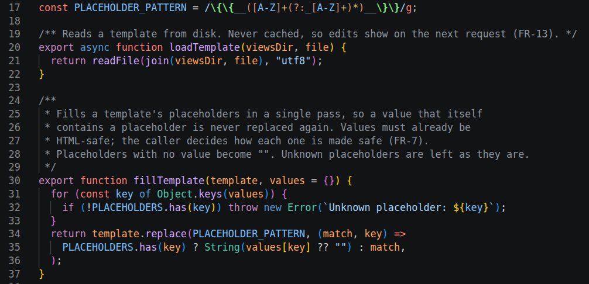
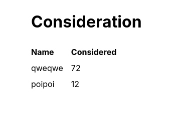
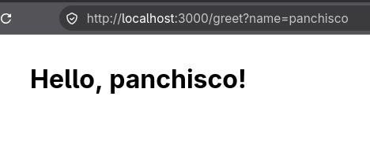
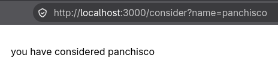
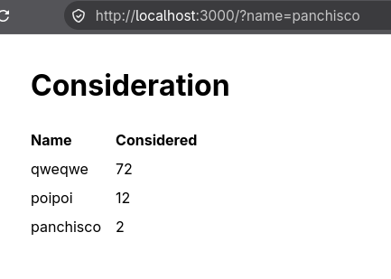

Human log of claude implementation of the viewer app

Things to know:

- The reason this project started was because job decided to move on to ai-first development.  
- Job decided to get a claude license for the team I’m in  
- I have to learn to use this tech as best as i can, in order to do a good job and not end up homeless living in a smelly alley rambling about the reptilian overlords  
- It may possibly be fun to sit in an alley yelling about the mysteries of the divine existence.

The purpose of this doc is to dump the human view of using this ai tech to do development. The examination is interpreting the process of creating a new app, creative design, and adjusting expectatives of working with the ai for the purpose of job matters

I got the ai license just a few days ago, and I have never done proper full ai development before. The only experience i had prior to this exercise was using free web based apps like google ai search.   
When the job assigned me to work with ai-first, they made a big deal of having their own ai framework to develop apps, and while that sounds like fun, in the assignment we got told to instead use aws-dlc, which seems to serve mostly the same purpose. There is too much complexity in both frameworks and its dubious whether they actually improve whatever situation would be their goal.

Personally, i prefer to learn matters from first principles. In the general case, i want to be able to find the similarities between things rather than their uniqueness, while also noting that every possible thing to exist in this physical existence is identically unique.

The way i like to learn is hands on experimentation, and exploring the limits and surface of the topic.   
To learn ai, i decided on creating a few experiments, starting from a simple app, then trying to make a complex tool.

The experience doing the simple app led me to think that one of the hardest parts of developing a real app with ai, will be the matter of examining the generated code, what it does and how it does it. For example, reading a PR which is mostly aigen code, is always really annoying. 

Doing the simple tool was a bit hard, it seems to me that the ai needs too much detail, and goes to very specific matters, rather quickly. Meaning that starting from a rough idea of what to do, it quickly wants data on the specifics like the tech stack, edge cases and many things that it just came with on its own. 

I dont know if my way of writing influences what the ai responds, or whether the claude is already designed to work in this way. Right now the idea is just to go with the flow and see how it goes.

After spending a few hours with claude, answering questions, the app ended up with a node server which rendered fragments of HTML which it constructs into a string in-memory and uses regexes to replace defined strings for renderings of the values. It includes a sqlite database to show how the ai decides on such things, the node server reads GET parameters and uses them for db search and HTML rendering. It has 3 endpoints counting /, /greet and /consider, which will fail when they receive a method distinct from GET.

The current url for this experiment is [https\://github.com/ZaidaZadkiel/ai\_experiments/tree/main/first\_test\_app/test](https://github.com/ZaidaZadkiel/ai_experiments/tree/main/first_test_app/test)

Since I started this exercise without thinking too much, simply as a starting point, i did not consider documenting, so this is mostly the end product as claude built it, and i did not keep any logs of the process. 

For the first experiment, it was the simplest with minimal complexity to see, so it was work of half a day. Most of the decisions were raised by the ai, while i mostly decided on the higher level details such as what each endpoint was supposed to do, what kind of complexity to try (in particular, specifically not using any ui framework and use only static html files). The ai decided on its own the implementation and i just worked on the claude.md and requirements.md files

Some time later, the requirements.md file seemed to be complete enough, and i asked several times to the ai “whats missing” so it could show what it decided it needed. In the end, building the app was a single query line, even if the ai still was showing several decisions that were missing.

Manually testing was kind of underwhelming, as one might suspect from a basic super simple app. I tested the flow, and didnt bother to try too many things, just sending the parameters and looking that the count increases from the database and is the data is displayed.

The code ai produced was very ai-like, naturally. It definitively had no concern for human readability, maybe i could have told the ai about that, but since i was just seeing what it does, i decided against being too detailed, as i wanted to see what it does with minimal instructions. I only read some parts of the code, and it did seem to me that if i wanted to actually understand, i would need to make more effort than i was interested in, since the manner in which the ai writes code is not very obvious, it looks good but it also is full of shortness, and because I did not instruct it to comment or anything, it only wrote code and the ai-style barely useful comments with references to the requirements file.![][image1]

[https\://github.com/ZaidaZadkiel/ai\_experiments/blob/main/first\_test\_app/test/REQUIREMENTS.md](https://github.com/ZaidaZadkiel/ai_experiments/blob/main/first_test_app/test/REQUIREMENTS.md)  

