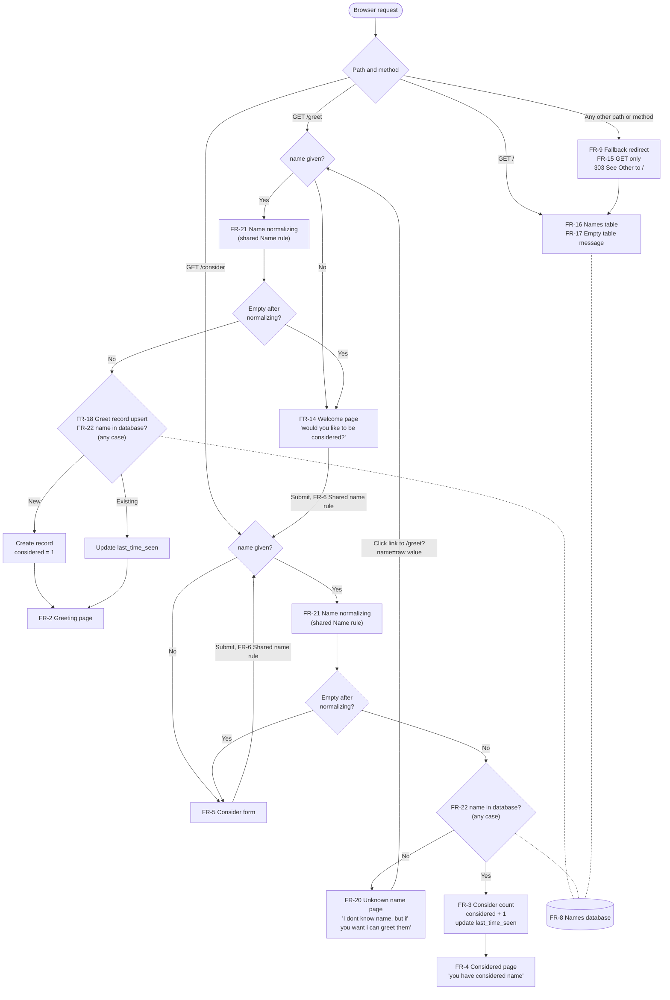

# Project Requirements

Nov 4, 2026 · @Zaida

## Overview

The purpose of this project is a Node.js app that runs an HTTP server with two endpoints, `/greet` and `/consider`, backed by a SQLite database. The database holds the details for each greeting: `name`, `last_time_seen` and `considered`.

The app is built: the server is in `src/`, the templates in `src/views/`, and the schema in `data/init.sql`. Each requirement below names the test file in `test/` that checks it. The old starter code was replaced. This document records the target behavior and the standards every new feature must meet.

## Functional requirements

The app must serve `/greet` and `/consider` over HTTP and store greeting details in SQLite.

| ID    | Name                   | Requirement                                                                                                                                                                                                                                                                                                                                                                                                                                                                                                                                                               | Verified by                           |
| ----- | ---------------------- | ------------------------------------------------------------------------------------------------------------------------------------------------------------------------------------------------------------------------------------------------------------------------------------------------------------------------------------------------------------------------------------------------------------------------------------------------------------------------------------------------------------------------------------------------------------------------- | ------------------------------------- |
| FR-1  | Server start           | The app starts an HTTP server when run with `npm start`                                                                                                                                                                                                                                                                                                                                                                                                                                                                                                                   | `server.test.js`                      |
| FR-2  | Greeting page          | `GET /greet?name=<name>` returns an HTML page with a greeting for the name passed in the `name` query string parameter                                                                                                                                                                                                                                                                                                                                                                                                                                                    | `server.test.js`                      |
| FR-3  | Consider count         | `GET /consider?name=<name>`, when `name` matches a record in the database, increases that record's `considered` counter by 1 and updates its `last_time_seen` to the current time                                                                                                                                                                                                                                                                                                                                                                                         | `server.test.js`, `db.test.js`        |
| FR-4  | Considered page        | After the increase in FR-3, the response is an HTML page with the text `you have considered <name>`, showing the name as received (FR-23)                                                                                                                                                                                                                                                                                                                                                                                                                                 | `server.test.js`                      |
| FR-5  | Consider form          | `GET /consider` with `name` missing, or empty after normalizing (FR-21), returns an HTML page with a form: one text field `name` and a submit button that sends `GET /consider?name=<value>`                                                                                                                                                                                                                                                                                                                                                                              | `server.test.js`                      |
| FR-6  | Shared name rule       | There is one name rule (see Name rule below). On the server it is defined once in shared code, used by every endpoint that reads a name; no endpoint has its own rule. In the browser, the forms check names with the same rule, adapted for the browser and embedded in the page as a `<script>`. A value the rule would change shows a message explaining what will be converted, but never blocks submitting: the form always submits, and the server normalizes the name (FR-21). The browser version must give the same result as the server version for every input | `name-rule.test.js`, `server.test.js` |
| FR-7  | Output escaping        | Every dynamic value is made HTML-safe exactly once. Names as received from the query string (FR-23) are escaped when they are placed in a page, so input such as `<script>` is displayed as text and never runs. Stored names are already HTML-safe after normalizing (FR-21), so they are inserted as they are, never escaped a second time (which would show `&amp;quot;` instead of `"`)                                                                                                                                                                               | `server.test.js`, `html.test.js`      |
| FR-8  | Names database         | A SQLite database stores one record per greeted name, with `name`, `last_time_seen` and `considered`                                                                                                                                                                                                                                                                                                                                                                                                                                                                      | `db/init.test.js`, `db.test.js`       |
| FR-9  | Fallback redirect      | Unknown paths, and any other invalid request (such as a method an endpoint does not accept), get a `303 See Other` redirect to `/` instead of a `404 Not Found` page                                                                                                                                                                                                                                                                                                                                                                                                      | `server.test.js`                      |
| FR-10 | Greeting text          | The greeting page says `Hello, <name>!`, showing the name as received (FR-23). It is new code; the starter `greet()` function is not reused                                                                                                                                                                                                                                                                                                                                                                                                                               | `server.test.js`                      |
| FR-11 | No HTML in code        | The server's JavaScript contains no HTML; every HTML page lives in its own static `.html` template file. A template may include its own embedded `<script>` when the page needs JavaScript, such as the name check in FR-6                                                                                                                                                                                                                                                                                                                                                | `server.test.js`                      |
| FR-12 | Placeholder templates  | Templates mark dynamic values with fixed, predefined `{{__PLACEHOLDER__}}` strings, which the server fills in by plain search and replace (no template engine)                                                                                                                                                                                                                                                                                                                                                                                                            | `templates.test.js`                   |
| FR-13 | Live template reload   | The server reads the template file from disk on each request, so an edited template shows on the next page load without restarting the server                                                                                                                                                                                                                                                                                                                                                                                                                             | `server.test.js`                      |
| FR-14 | Welcome page           | `GET /greet` with `name` missing or empty returns an HTML welcome page that says "welcome to the greeter page, consider who you want and see how much consideration everyone has", with a text field `name` and a button labelled "would you like to be considered?" that sends `GET /consider?name=<value>`, starting the `/consider` flow                                                                                                                                                                                                                               | `server.test.js`                      |
| FR-15 | GET only               | `/greet` and `/consider` accept only `GET`; any other method (`POST`, `PUT`, `DELETE`, `HEAD`, …) gets a `303 See Other` redirect to `/`                                                                                                                                                                                                                                                                                                                                                                                                                                  | `server.test.js`                      |
| FR-16 | Names table            | `GET /` returns an HTML page with a table of two columns only, name and consideration count, for every registered name, sorted by `considered` from highest to lowest (ties sorted by name, A to Z). The table only displays data: no links and no `last_time_seen`                                                                                                                                                                                                                                                                                                       | `server.test.js`, `db.test.js`        |
| FR-17 | Empty table message    | When no names are registered, `/` shows the message "Nobody has been greeted yet." instead of an empty table                                                                                                                                                                                                                                                                                                                                                                                                                                                              | `server.test.js`                      |
| FR-18 | Greet record upsert    | `GET /greet?name=<name>` with a new name creates a record with that `name`, `last_time_seen` set to the current time and `considered` set to 1; with an existing name, it updates only `last_time_seen` to the current time                                                                                                                                                                                                                                                                                                                                               | `server.test.js`, `db.test.js`        |
| FR-19 | HTML or redirect only  | Every response is either an HTML page (`Content-Type: text/html; charset=utf-8`) or a `303 See Other` redirect to `/`; no plain text or JSON responses                                                                                                                                                                                                                                                                                                                                                                                                                    | `server.test.js`                      |
| FR-20 | Unknown name page      | `GET /consider?name=<name>` with a name not in the database returns an HTML page saying `I dont know <name>, but if you want i can greet them`, showing the name as received (FR-23). The link goes to `/greet?name=<raw>`, where `<raw>` is the `name` query value exactly as received, not validated or normalized, only URL-encoded so it is a working link. `/greet` then normalizes it once, so the name is never converted twice                                                                                                                                    | `server.test.js`, `html.test.js`      |
| FR-21 | Name normalizing       | Every name, from any endpoint and in every case, goes through one shared normalizing function: trim spaces at both ends, apply the Name rule conversions, and stop at the maximum length. The result is used for every database step and page that follows. No endpoint has its own validation or normalizing                                                                                                                                                                                                                                                             | `name-rule.test.js`, `server.test.js` |
| FR-22 | Case-insensitive names | Names are compared without regard to case everywhere: `Ada`, `ada` and `ADA` are the same record. A record keeps the spelling it was first created with, and the names table shows that spelling                                                                                                                                                                                                                                                                                                                                                                          | `server.test.js`, `db.test.js`        |
| FR-23 | Name display           | Pages that answer a request (greeting, considered, unknown name, and the refilled form field) show the name exactly as it is in the `name` query value, escaped for HTML (FR-7). The database always saves the normalized form (FR-21), and the names table shows the saved form. For example, `/greet?name=José` shows `Hello, José!` and saves `Jos_`                                                                                                                                                                                                                   | `server.test.js`                      |
| FR-24 | Optional message       | Every page template has a `{{__MESSAGE__}}` slot. It is empty unless there is something meaningful to tell the person, such as a name that had no usable characters after normalizing. It is never used for errors (FR-25). An empty message leaves no visible trace on the page                                                                                                                                                                                                                                                                                          | `server.test.js`                      |
| FR-25 | Crash on fatal errors  | The app assumes the database, file system, templates and network always work, and has no error pages or error handling for them. Any unexpected or fatal error (a missing template, a database failure, the port already in use) is not caught: the server crashes and stops                                                                                                                                                                                                                                                                                              | `db.test.js` (missing database)       |
| FR-26 | Test database path     | The function that starts the server takes an optional database path. `npm start` never passes one, so the app always uses the fixed `data/app.db`. Only tests pass a path, to a temporary database, so they never touch the real file                                                                                                                                                                                                                                                                                                                                     | `server.test.js`                      |
| FR-27 | First name value       | When the query string has more than one `name` (`?name=a&name=b`), only the first value is used and the others are ignored                                                                                                                                                                                                                                                                                                                                                                                                                                                | `server.test.js`                      |
| FR-28 | Safe counter update    | The consideration count is increased in a single database statement (`considered = considered + 1`), so two requests at the same moment never lose a count                                                                                                                                                                                                                                                                                                                                                                                                                | `server.test.js`, `db.test.js`        |

### App flow

Every request ends on one of six HTML pages or a redirect to `/`.

These requirements apply to every page, so they are not drawn as steps: FR-1 Server start, FR-7 Output escaping, FR-10 Greeting text, FR-11 No HTML in code, FR-12 Placeholder templates, FR-13 Live template reload and FR-19 HTML or redirect only.

### Name rule

A name is valid when it is made of letters and digits, and may also contain underscores, spaces and other printable characters. Characters that would break the HTML page or a URL are converted, never rejected (FR-21).

| Input character                                                                                                     | Becomes                                |
| ------------------------------------------------------------------------------------------------------------------- | -------------------------------------- |
| `A` to `Z`, `a` to `z`, `0` to `9`, `_`, space                                                                      | Kept as is                             |
| Any other printable ASCII character (codes 32 to 126), such as `! $ ( ) * , - . : ; @ [ \ ] ^ { \| } ~` and `` ` `` | Kept as is                             |
| `<` `>` `&` `"` `'` (break HTML display)                                                                            | `&lt;` `&gt;` `&amp;` `&quot;` `&#39;` |
| `?` `#` `%` `+` `/` `=` (break URLs)                                                                                | `_`                                    |
| Letters outside `A` to `Z`, such as `é` or `ñ`                                                                      | `_`                                    |
| Anything not renderable: tabs, line breaks, control characters                                                      | `_`                                    |

- Spaces inside a name are kept; spaces at the start or end are trimmed. A name that is empty after normalizing counts as missing.
- The maximum length is 50 characters, counted before conversion, so `&quot;` counts as one character.

| Input        | Stored as (and shown in the names table) |
| ------------ | ---------------------------------------- |
| `Juan Perez` | `Juan Perez`                             |
| `  Juan`     | `Juan`                                   |
| `José`       | `Jos_`                                   |
| `O'Brien`    | `O&#39;Brien` (displays as `O'Brien`)    |
| `AC/DC`      | `AC_DC`                                  |
| `   `        | Empty, so treated as missing             |

- Because names are stored converted, every stored name is already safe to place in HTML (FR-7).
- Converting is not repeatable: running a converted name through the rule again changes it (`&#39;` would become `&amp;_39;`). So a name is normalized exactly once per request, and links carry the original value, never a converted one (FR-20).

### `/` and invalid requests

1. `GET /` returns the names table (FR-16, FR-17).
2. An unknown path or other invalid request redirects to `/` with `303 See Other` (FR-9, FR-15). The browser then loads `GET /`, so every dead end lands on the names table.
3. This includes `/favicon.ico`, which browsers request on every page load. The extra redirect and names table query are accepted; the app serves no icon.

### `/greet` flow

1. Read `name` from the query string.
2. If `name` is missing or empty, return the welcome page (FR-14). Submitting its form goes to the `/consider` flow below.
3. Normalize `name` with the shared function (FR-21). If nothing is left, return the welcome page (FR-14).
4. Look up the name, ignoring case (FR-22). If it is new, create its record. If it already exists, update its `last_time_seen` (FR-18).
5. Return the greeting page for `name` (FR-2).

### `/consider` flow

1. Read `name` from the query string.
2. If `name` is missing or empty, return the form page (FR-5).
3. Normalize `name` with the shared function (FR-21). If nothing is left, return the form page (FR-5).
4. Look up the name in the database, ignoring case (FR-22). If there is no matching record, return the unknown name page (FR-20). Its text shows the name as received (FR-23); its link passes the original, unnormalized `name` value to `/greet?name=<raw>`. Following that link registers the name through the `/greet` flow.
5. Otherwise, increase `considered` by 1 and update `last_time_seen` for that record, then return the page saying `you have considered <name>` (FR-3, FR-4).

### HTML templates

HTML lives only in static template files, which the server fills in with predefined placeholders (FR-11 to FR-13).

- **Location:** `src/views/`, with one file per page or fragment:
  - `index.html`: the names table page at `/`
  - `index-row.html`: one table row, repeated once per name
  - `index-empty.html`: the "no names registered yet" message
  - `greet.html`: the welcome page
  - `greeting.html`: the greeting page for a given name
  - `consider.html`: the form page
  - `considered.html`: the "you have considered <name>" page
  - `unknown.html`: the "I dont know <name>, but if you want i can greet them" page
  - `name-rule.html`: the `<script>` with the browser version of the name rule, inserted into `greet.html` and `consider.html` so the browser code also exists only once
- **Placeholders:** a fixed list, written as `{{__NAME__}}` style strings. Each value is made HTML-safe exactly once (FR-7): values from the request are escaped, stored names are inserted as they are, and fragments (`{{__ROWS__}}`, `{{__NAME_RULE__}}`) are inserted as is.
- **Repeated rows:** because the JavaScript holds no HTML (FR-11), the table's rows come from `index-row.html`. The server fills one copy per name and joins them into `{{__ROWS__}}`. Rows are already escaped, so `{{__ROWS__}}` is inserted as is.

| Placeholder          | Replaced with                                                                                                                                                  | Used in                                                                                                              |
| -------------------- | -------------------------------------------------------------------------------------------------------------------------------------------------------------- | -------------------------------------------------------------------------------------------------------------------- |
| `{{__NAME__}}`       | The `name` query value as received, escaped for HTML (FR-23). In the form, it refills the text field                                                           | `greeting.html`, `consider.html`, `considered.html`, `unknown.html`                                                  |
| `{{__ROW_NAME__}}`   | One row's stored name, inserted as is because it is already HTML-safe                                                                                          | `index-row.html`                                                                                                     |
| `{{__NAME_URL__}}`   | The `name` query value exactly as received (not validated or normalized), URL-encoded for the link, such as `O%27Brien` in `/greet?name={{__NAME_URL__}}`      | `unknown.html`                                                                                                       |
| `{{__MESSAGE__}}`    | An optional message, escaped for HTML, shown only when there is something meaningful to say, such as a name with no usable characters; otherwise empty (FR-24) | Every page template: `index.html`, `greet.html`, `greeting.html`, `consider.html`, `considered.html`, `unknown.html` |
| `{{__CONSIDERED__}}` | The row's consideration count                                                                                                                                  | `index-row.html`                                                                                                     |
| `{{__ROWS__}}`       | All filled-in rows from `index-row.html`, or the contents of `index-empty.html`                                                                                | `index.html`                                                                                                         |
| `{{__NAME_RULE__}}`  | The contents of `name-rule.html`, inserted as is                                                                                                               | `greet.html`, `consider.html`                                                                                        |

- **Styling:** any CSS goes inside the templates, in a `<style>` element, because every response is an HTML page or a redirect (FR-19). Like the name check script, it can live in a shared fragment if several pages need it.
- **No restart needed:** templates are not cached in memory. Each request reads the file again, so saving a template is enough to see the change. `npm run dev` restarts only when JavaScript files change, so editing a template never triggers a restart.
- **Tests** check that:
  - the JavaScript in `src/` contains no HTML markup
  - changing a template file changes the next response without restarting the server
  - the browser name check in `name-rule.html` and the server's normalizing function give the same result for every example in the Name rule section

### Data model

One table, `names`. The schema lives in `data/init.sql`.

| Column           | Meaning                                                 | Type                              |
| ---------------- | ------------------------------------------------------- | --------------------------------- |
| `name`           | The person being greeted; unique, ignoring case (FR-22) | `TEXT PRIMARY KEY COLLATE NOCASE` |
| `last_time_seen` | When this name was last greeted or considered           | `TEXT`, ISO 8601 timestamp (UTC)  |
| `considered`     | How many times this name has been considered            | `INTEGER NOT NULL DEFAULT 1`      |

### Database setup

The database is created manually, before the first `npm start`. The app does not create it (FR-25: a missing database is a fatal error).

- `data/init.sql` holds the schema. It uses `CREATE TABLE IF NOT EXISTS`, so it can be run again safely.
- `npm run db:init` creates the database file at `data/app.db` (and its folder, if missing) and imports `data/init.sql`. Running it again keeps existing data.
- The database files (`data/*.db` and SQLite's `-journal`, `-wal` and `-shm` files) are ignored by git; `data/init.sql` is committed.
- Node 22 prints an `ExperimentalWarning` the first time `node:sqlite` is used. It is expected and harmless.

## Technical requirements

The project runs on Node.js 22.13 or later, in plain JavaScript using ES modules.

| Area                 | Requirement                                                                                        | Where it is set                       |
| -------------------- | -------------------------------------------------------------------------------------------------- | ------------------------------------- |
| Runtime              | Node.js 22.13 or later, needed to use `node:sqlite` without an experimental flag                   | `engines` in `package.json`, `.nvmrc` |
| HTTP server          | Built-in `node:http`; no web framework unless approved                                             | `CLAUDE.md` (prefer built-ins)        |
| Database             | SQLite via the built-in `node:sqlite` module; no third-party driver unless approved                | `CLAUDE.md` (prefer built-ins)        |
| Language             | Plain JavaScript, no TypeScript or build step                                                      | `CLAUDE.md`                           |
| Modules              | ES modules only (`import`/`export`); no `require` or `__dirname` (use `import.meta.dirname`)       | `"type": "module"` in `package.json`  |
| Async code           | `async`/`await`, not callbacks                                                                     | `CLAUDE.md`                           |
| Runtime dependencies | None today. Prefer Node built-ins (`node:http`, `node:sqlite`, `node:test`); ask before adding one | `CLAUDE.md`                           |
| Dev dependencies     | ESLint 10, `@eslint/js`, `globals`, Prettier 3                                                     | `devDependencies` in `package.json`   |
| Lockfile             | `package-lock.json` must be committed; `npm ci` gives a clean install from it                      | Repository root                       |

## Configuration requirements

All configuration comes from environment variables.

| Variable | Purpose                         | Default |
| -------- | ------------------------------- | ------- |
| `PORT`   | Port the HTTP server listens on | `3000`  |

- The database path is fixed at `data/app.db`, inside the project folder; it is not configurable.
- `npm start` and `npm run dev` load a `.env` file when one exists (`--env-file-if-exists`).
- Every new variable must be documented in `.env.example`, with a safe placeholder value.
- `.env`, the database file and any secrets must never be committed.

## Quality and development workflow

A task is done only when `npm run check` passes: lint, format check and tests. There is no CI, so the check is run locally, and work stays on the `master` branch.

| Command                           | What it does                                          |
| --------------------------------- | ----------------------------------------------------- |
| `npm start`                       | Starts the server (run `npm run db:init` once first)  |
| `npm run dev`                     | Runs with auto-restart on file changes                |
| `npm run db:init`                 | Creates the database file and imports `data/init.sql` |
| `npm test`                        | Runs tests with the built-in `node:test` runner       |
| `npm run lint` / `lint:fix`       | Checks / fixes code with ESLint                       |
| `npm run format` / `format:check` | Formats / checks code with Prettier                   |
| `npm run check`                   | Lint + format check + tests                           |

- Tests live in `test/`, are named `*.test.js`, and mirror the layout of `src/`.
- Every behavior change ships with new or updated tests.
- Endpoint tests start the server on a random port with a temporary database: a file in the system temp folder, created with `initDatabase` and deleted afterwards (FR-26). They never touch `data/app.db`.
- Editor settings follow `.editorconfig`; formatting follows `.prettierrc`.

## Open questions

None right now. New questions go here as they come up.
