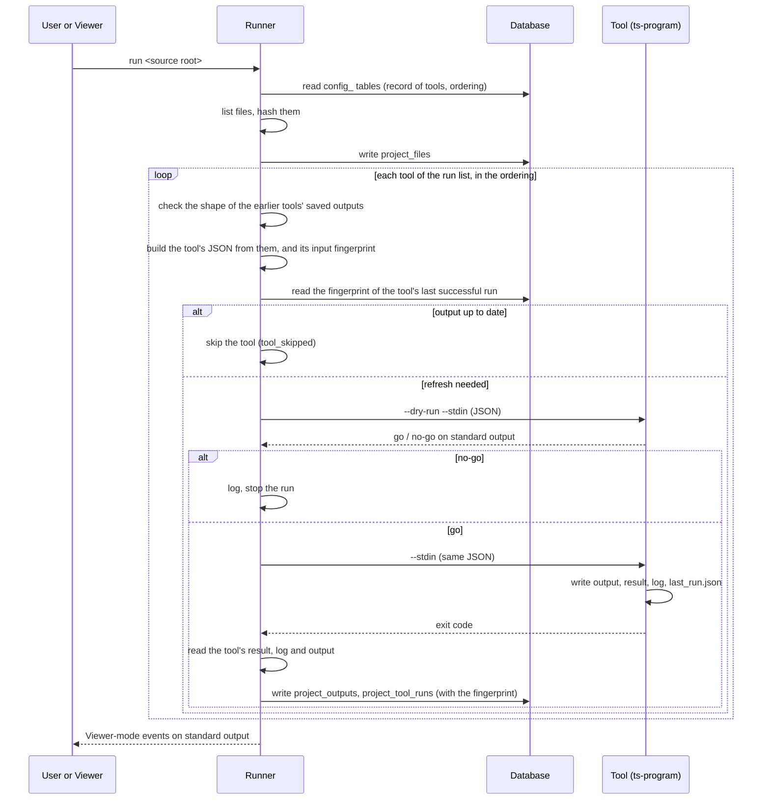

# 01. Architecture

## Components

| Component | Language | Role in the MVP |
|---|---|---|
| **Runner** | TypeScript (Node) | Builds the file list, keeps the record of tools and the ordering, builds each tool's JSON, dry-runs then runs each tool, reads outputs and logs, updates the database, answers the Viewer |
| **Viewer backend** | TypeScript (Node) | Local HTTP server. Calls the Runner, reads the Runner's cache through `--read-cache` (`ARCH-11`, `VIEW-03`), reads source lines, serves the UI |
| **Viewer UI** | TypeScript in the browser | Shows the levels, the details of a selection, the tool list and go / no-go results. Only displays |
| **Shared library** | TypeScript | Used by the Runner and the Viewer backend: database access, log reader, `--info` types, Runner output types (`runner.md`, section 1.0) |
| **ts-program** | TypeScript (Node) | Runs TypeScript's own compiler over every listed `.ts` file in one invocation, and writes per source file its declarations, every use resolved to its declaration, and its import links (`TOOL-50`). The only tool the Runner runs (`RUN-33`) |
| **M1 file-symbols** | TypeScript (Node) | Reads one source file, outputs its symbols and references. Kept as built, not run (`TPG-01`) |
| **M2 cross-file-links** | TypeScript (Node) | Reads no files; links imports to the declarations they refer to. Kept as built, not run (`RUN-33`) |
| **M3 symbol-scope** | TypeScript (Node) | Reads no files; outputs scopes and which scope each symbol belongs to. Kept as built, not run (`RUN-33`) |

- **ARCH-01** The Runner and the Viewer are one unit, in one repository, built together.
- **ARCH-02** Each tool is a separate program with its own entry point. It imports nothing from the Runner, the Viewer or another tool. It may import a small tool helper module (parameters, logs, `last_run.json`) that knows nothing about any specific tool.
- **ARCH-03** Tools are started as separate processes, with arguments passed as an array, never through a shell command string (`security.md`, section 7).

## Flow of a run



- **ARCH-04** Not in force in MVP 2: the Runner runs the tools of its run list, `ts-program` alone (`RUN-33`). MVP 1 text: `mvp1/docs_2026-11-10/01_architecture.md`.
- **ARCH-05** A run refreshes only the outputs that need it (`RUN-17` to `RUN-22`). With nothing saved, every tool runs and every output is produced; with nothing changed, no tool runs. This follows `toolset.md`, section 5.3 [Decided], and departs from `MVP_scope.md`, section 6, which leaves incremental runs out of the MVP (`FND-36`).

## Layout on disk

Answers `MVP-13` for the MVP.

```
zaansouvi-mvp/
  app/
    shared/                         Runner–Viewer library
    tool-helper/                    small helper any TypeScript tool may use
    runner/
    viewer/
      server/
      ui/
    tools/
      ts-program/
        ts-program                  launcher (the "tool_name.bin"); nothing is written here
      file-symbols/                 M1, kept, not run
        file-symbols
      cross-file-links/             M2, kept, not run
        cross-file-links
      symbol-scope/                 M3, kept, not run
        symbol-scope
  data/
    zaansouvi.sqlite                the single database (config_ and project_ tables)
    tools/
      ts-program/
        output/<file-key>.json      one per examined .ts file: its symbols, references and links
        result.json
        last_run.json               in the store (ARCH-06)
        logs/<timestamp>_program.log
      file-symbols/
        output/<file-key>.json      one per examined file
        result.json
        last_run.json               in the store (ARCH-06)
        logs/<timestamp>.log
        state/                      unused in the MVP
      cross-file-links/
        output/links.json
        result.json
        logs/<timestamp>.log
      symbol-scope/
        output/scopes.json
        result.json
        logs/<timestamp>.log
    runner/
      logs/<timestamp>.log
      cache.json                    the Runner's cache: what --read-cache prints (RUN-27)
    viewer/                         the Viewer's own store, JSON files, Viewer only (VIEW-06)
      sources.json                  the sources cached, each with its source root and run (VIEW-08)
      activity.log                  the activity log, appended, one backend only; may be cleared (VIEW-17)
      sources/<source-key>/
        last-good-graph.json        that source's graph from its last successful real run
  test-source-mvp2/                 MVP 2's examined source, the class-heavy test (FND-92)
  expected-mvp2/                    its expected graph, written by hand
  test-source/                      the basic examined source of M1, M2 and M3 (06_test_plan.md)
  expected/                         its expected result, written by hand
```

- **ARCH-06** `last_run.json` sits in each tool's store, `data/tools/<tool>/last_run.json` for the Runner's runs; program folders are never written (`toolset.md`, section 4.5).
- **ARCH-07** `<file-key>` is the file ID with `/` replaced by `__`, so `src/math.ts` becomes `src__math.ts.json`.
- **ARCH-08** The examined source is never written to. Nothing goes outside `zaansouvi-mvp/` except the system temp, which the MVP doesn't need.
- **ARCH-09** The data folder can be deleted at any time; the next run rebuilds it, except the database's `config_` tables, which the Runner recreates on start (`03_runner.md`). With `last_run.json` in the stores (`ARCH-06`), the data folder holds all of the Runner's state: deleting it, or moving it aside, is a full reset. Tools run by hand with no store keep theirs in `./zaansouvi/tools/` of the folder they were started from. Clearing only the Runner's and the tools' data (the database, `runner/`, `tools/`) leaves the Viewer's cache in `data/viewer/` (`VIEW-09`).

## The single database

- **ARCH-10** One SQLite file holds both configuration and codebase data (`MVP_scope.md`, section 4). Tables start with `config_` or `project_`. The tables are listed in `02_data_contracts.md`.
- **ARCH-11** The Runner writes all tables. In the MVP the Viewer backend reads none of them: it reads only the Runner's cache, through `--read-cache` (`RUN-27`), and writes only its own store, `data/viewer/` (no config manager; `VIEW-06`).

## Technology choices for the MVP

These satisfy "use a library or built-in when one does the job". Versions are pinned when the project is set up.

| Need | Choice | Why |
|---|---|---|
| Runtime for the Runner, the Viewer backend and the tools | Node.js, with TypeScript | Decided stack; one runtime for everything |
| Analyzing TypeScript in `ts-program` | The TypeScript compiler's program and type checker (`typescript` package, pinned; `TPG-10`) | TypeScript's own answer for every declaration and every use, across files (`TPG-02`, `TPG-11`) |
| Parsing TypeScript in M1 | The TypeScript compiler's own parser (`typescript` package, `ts.createSourceFile`) | Exact syntax tree with positions, no type checking needed, one file at a time (`MVP-7`) |
| Database | SQLite through Node's built-in `node:sqlite` (still experimental in Node 22; its warning hidden as in M1's launcher). `better-sqlite3` only if `node:sqlite` fails | Single file, no server, nothing to install |
| Starting tools | Node's `child_process.spawn` with an argument array | No shell, so no injection from file names |
| HTTP server | Node's built-in `http` module | Least effort; a handful of endpoints |
| Graph in the browser | Cytoscape.js | Supports compound nodes (nodes inside nodes) and has built-in layouts |
| The page's code in the browser | TypeScript compiled by `tsc` into ES modules, no bundler; Cytoscape's prebuilt file served from the local install (`55_viewer_backend.md`, `BE-90`) | Browsers run only JavaScript; Node's type stripping covers the server, not the page. One build step, no extra tool |
| Hashing files | Node's built-in `crypto` (SHA-256) | Built in |
