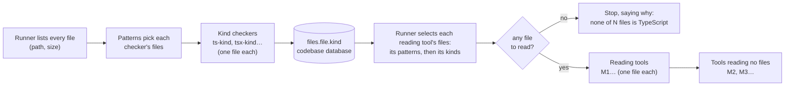

# 40. Tools for file kinds (proposal)

A proposal for the tool or tools that output `files.file.kind`: what kind each listed file is, and whether a tool can read it. It covers the tools themselves, a suggested description of the file kinds database, and how the Runner uses it. Written on 2026-11-09 at the user's request (`FND-80`).

**Status: a proposal, deferred until after the MVP** (decided by the user on 2026-11-09). It is not part of the MVP's build or its success criteria; the decisions it needs are listed in section 8, to be taken when the work starts. Nothing here is built, and nothing here is decided unless it cites a decision in a working file. Items are marked **[Decided]** (decided elsewhere, cited), or **[Suggested]** (this proposal). IDs use the prefix `KIND`. It is the first step of the work planned first after the MVP, the file inventory (`toolset.md`, section 6.2). Field names and formats are examples, to be settled in the technology step.

## 1. Why

What the MVP showed, and what this answers:

| Case | Today | With file kinds |
|---|---|---|
| A JavaScript project (`FND-75`) | no files listed; M2 fails with an error pointing away from the cause | "file-symbols reads TypeScript: none of the 57 files listed is TypeScript", before any analysis tool runs |
| A video named `.ts` (MPEG transport stream, common for TV recordings) | M1 fails on it, and the run stops at the first failure (`RUN-08`) | the file is classified as video and never given to M1; the run goes on |
| A `.tsx` file (React style code) | not listed; if it were, M1 would fail on its JSX | classified as its own kind, for its own tool |
| A `.d.ts` declaration file | read as ordinary code | classified as a declaration file; a tool chooses whether to read it |
| A huge, generated or minified file | slow, and floods the graph | classified as too large or generated, and skipped with a reason |
| A file that isn't valid text (another encoding, stray binary bytes) | parse error, or garbage symbols | classified as not readable as text |

### 1.1 Evidence from a test (2026-11-09, `FND-81`)

M1 was fed JavaScript with no code changed:
- **As `.js`**, M1 refuses the file in its own parameter check (`E12`, "reads only \*.ts files"), so a name alone already decides, three times over (the Runner's listing, M1's `--info`, M1's check).
- **Plain JavaScript under a `.ts` name** parses, but is misread: a class used in its own file shows as unresolved, its members are missing, `require` is not an import. Nothing tells the user why.
- **JSX under a `.ts` name** doesn't parse (9 syntax errors), and its no-go would stop the whole run.

So a file's name misroutes its content both ways, and one such file stops everything today. A checker reading the bytes would classify these as `javascript` and `javascript-jsx`, keep them from M1, and report them as skipped with the reason, while the run goes on. The data-flow changes this implies are listed in `FND-81`.

## 2. What it must respect

All decided in the working files:
- **KIND-01 [Decided]** The file list is the Runner's: every file, its path and hash. The file inventory stays a tool that determines each file's kind with its own heuristics (`toolset.md`, section 6.2; `RN-13`).
- **KIND-02 [Decided]** After the MVP, the file inventory is the first tool to start on. It determines whether each file can be read and what kind of data to expect from it (`toolset.md`, section 6.2; `FND-75`).
- **KIND-03 [Decided]** A tool reads one file per invocation (`toolset.md`, section 4.2).
- **KIND-04 [Decided]** **One file type for one tool.** A tool that reads files states valid patterns for the one file type it reads; reading a composite, or a file matching no specific pattern, is a design error and unsupported. Several kinds are read by several tools, and a tool reading no files combines their outputs (`toolset.md`, section 4.2; `DATA-23`; `FND-79`).
- **KIND-05 [Decided]** Tools never read or write a database. Only the Runner does, from the tools' outputs (`toolset.md`, section 5.2).
- **KIND-06 [Decided]** Each file's kind goes in the codebase database. The configuration database holds no data about any examined codebase (`toolset.md`, section 5.2).
- **KIND-07 [Decided]** Tools describe themselves with `--info`; there is no manifest (`data_topology.md`, `DT-1`). The Runner knows tools only through it (`RUN-25`).

**The consequence for the inventory.** A single inventory tool reading every file would need a pattern for every file, which `KIND-04` forbids. So "the file inventory" becomes **a family of small tools, one per file type**, called **kind checkers** here. This needs noting in `toolset.md`, section 6.2, which still describes one tool invoked on every listed file.

## 3. The kind checkers

### 3.1 What one is

- **KIND-10 [Suggested]** A kind checker is an ordinary tool: one file per invocation, one file type, patterns in `--info`, its output in its own store. It is **light**: it looks at a file's bytes and name, never parses it. Parsing stays the job of the tool that reads that kind (M1 for TypeScript), so no file is parsed twice.
- **KIND-11 [Suggested]** **A checker gives a verdict, not an error, for a file it doesn't like.** A video named `.ts` is a successful check with the kind `video-mpegts`, not a failure. A checker fails only when it can't do its job: a file it can't open, or an invocation error. So one odd file never stops the run.
- **KIND-12 [Suggested]** Its output, per file: the file ID, the **kind** it assigns, whether the file is **readable as text**, and the **evidence**, short reasons a person can check ("no NUL bytes in the first 64 KB", "sync byte 0x47 every 188 bytes", "name ends in .d.ts"). Also simple measurements: size, line count, encoding.

### 3.2 The first checkers

| Checker | Patterns | Kinds it can assign |
|---|---|---|
| **`ts-kind`** | `*.ts`, `*.mts`, `*.cts` | `typescript`, `typescript-declaration` (`.d.ts`), `video-mpegts`, `binary`, `not-utf8`, `too-large`, `generated` |
| **`tsx-kind`** | `*.tsx` | `typescript-jsx`, `binary`, `not-utf8`, `too-large`, `generated` |
| later, one per type | `*.json`, `*.sql`, `*.js`… | `json`, `sql`, `javascript`… |

- **KIND-13 [Suggested]** Whether `*.mts` and `*.cts` count as the same file type as `*.ts` is open (`toolset.md`, section 4.2, To define). They parse alike, so this proposal groups them; `.tsx` does not parse alike, so it gets its own checker.
- **KIND-14 [Suggested]** Checks a TypeScript checker makes, in order, stopping at the first that decides:
  1. **size** over a limit: `too-large`;
  2. **binary**: NUL bytes in the first block, or the MPEG transport stream pattern (byte 0x47 at the start of every 188-byte packet): `video-mpegts` or `binary`;
  3. **encoding**: not valid UTF-8: `not-utf8`;
  4. **name**: ends in `.d.ts`: `typescript-declaration`;
  5. **generated**: a generated-code marker on the first lines, or very long lines typical of minified code: `generated`;
  6. otherwise `typescript`.

### 3.3 Its `--info`, as an example

```json
{
  "tool": "ts-kind",
  "toolVersion": "0.1.0",
  "invocation": "per-file",
  "readsFiles": { "filePatterns": ["*.ts", "*.mts", "*.cts"], "parameter": "file_path", "fallback": "source_root + file_id" },
  "parameters": [ { "name": "source_root", "dataName": "project.source_root", "required": true } ],
  "kinds": [
    { "kind": "typescript", "readableAsText": true, "description": "TypeScript source" },
    { "kind": "typescript-declaration", "readableAsText": true, "description": "A .d.ts declaration file" },
    { "kind": "video-mpegts", "readableAsText": false, "description": "An MPEG transport stream video named .ts" },
    { "kind": "binary", "readableAsText": false, "description": "Binary content" },
    { "kind": "not-utf8", "readableAsText": false, "description": "Text not in UTF-8" },
    { "kind": "too-large", "readableAsText": false, "description": "Over the size limit" },
    { "kind": "generated", "readableAsText": true, "description": "Generated or minified code" }
  ],
  "outputs": [ { "dataName": "files.file.kind", "represents": "attributes", "attributeOf": "files.file" } ]
}
```

- **KIND-15 [Suggested]** **`kinds` is new in `--info`:** the kinds this checker can assign, each with a description and whether it is readable as text. The Runner builds the kind catalog from it (section 4.1).
- **KIND-16 [Suggested]** **`represents: "attributes"` is a new kind of output:** a fact about an existing node (here a file), not a node, relation or containment (`DATA-10` has only those three). The Viewer can show attributes in Details and style by them, with no tool-specific code. This needs a decision, since it widens `DATA-10`.

## 4. The file kinds database

Two parts, one in each database, following `KIND-05` and `KIND-06`.

### 4.1 The kind catalog: what kinds exist (configuration database)

- **KIND-20 [Suggested]** A table describing every kind any installed checker can assign, rebuilt by the Runner from the checkers' `--info` whenever the record of tools changes, like the ordering (`runner.md`, section 2). It holds no data about any codebase, so it may sit in the configuration database (`KIND-06`).

| Column (example) | Meaning |
|---|---|
| `kind` | the kind's name, unique across all checkers |
| `checker` | the tool that assigns it |
| `patterns` | that checker's file patterns |
| `readable_as_text` | whether a tool can read the file as text |
| `description` | one sentence, shown by the Viewer |
| `catalog_version` | changes when a checker's `kinds` change, so stored kinds can be rechecked |

- **KIND-21 [Suggested]** **Consistency, checked by the Runner when it builds the catalog:** a kind name claimed by two checkers, or two checkers with overlapping patterns, makes the record of tools inconsistent, and the Runner refuses both, saying why. Overlapping checkers would give one file two kinds; with one file type per tool (`KIND-04`) they shouldn't exist.

### 4.2 Each file's kind (codebase database)

- **KIND-22 [Suggested]** A table beside the file list (`project_files`), one row per file a checker looked at, loaded by the Runner from the checker's output after it succeeds (`toolset.md`, section 5.2).

| Column (example) | Meaning |
|---|---|
| `file_id` | the file, as in the file list |
| `kind` | the kind assigned, a name from the catalog |
| `checker`, `checker_version` | who assigned it |
| `checked_sha256` | the file's hash when it was checked |
| `readable_as_text` | copied from the catalog, so a reader needs no join |
| `evidence` | the checker's reasons |
| `size`, `lines`, `encoding` | its measurements |

- **KIND-23 [Suggested]** **A file no checker's patterns match has no row,** and is reported as **unchecked**: listed, never given to any tool. "Unchecked" is not a kind a tool assigns; the Runner reports it from the absence of a row.
- **KIND-24 [Suggested]** **A kind is valid only for the content it was checked on.** When a file's hash differs from `checked_sha256`, its kind is stale and the checker runs on it again (section 5.3). A change of the checker's version or catalog also makes its kinds stale.

## 5. How the Runner uses it



### 5.1 Selecting each tool's files

- **KIND-30 [Suggested]** A tool that reads files states, beside its patterns, **the kinds it reads**:

  ```json
  "readsFiles": { "filePatterns": ["*.ts"], "kinds": ["typescript"], "parameter": "file_path", "fallback": "source_root + file_id" }
  ```

  The Runner gives it a file only when **both** match: the patterns, cheap, known before any checker runs; then the kind, known after. M1 would read `typescript` only, leaving declaration files, videos and generated code alone.
- **KIND-31 [Suggested]** A tool stating `kinds` **depends on the checkers that assign them**, found through the catalog. So the ordering puts each checker before the tools that read its kinds, derived like every other dependency (`data_topology.md`, section 6), with no hand-written order.
- **KIND-32 [Suggested]** **A file whose kind a tool doesn't read is not a failure.** The Runner records it as "not applicable: `video-mpegts`" for that tool, beside "up to date", and goes on.

### 5.2 Stopping early with a clear reason

- **KIND-33 [Suggested]** After the checkers and before any reading tool, the Runner checks that each reading tool has at least one file to read. When one has none, it stops with a message built from `--info` and the kinds found, naming no language itself:

  > file-symbols reads files of kind typescript: none of the 57 files listed has it. 3 match its patterns (*.ts): 2 are video-mpegts, 1 is typescript-declaration. 54 match no tool's patterns.

  This is the generic answer to `FND-75`, and the reason a source can't be examined comes before any analysis tool runs (`KIND-02`).
- **KIND-34 [Suggested]** Whether "no file to read" stops the run or only skips that tool (and those depending on it) is to decide. Stopping is suggested for now, matching `RUN-08`.

### 5.3 Change detection and hashing

- **KIND-35 [Suggested]** The Runner hashes only files some checker's patterns match (`FND-79`): others are listed by path and size. A checker runs on a file again only when its hash, the checker's version or the catalog changed (`KIND-24`), as any tool is refreshed (`RUN-17` to `RUN-22`).
- **KIND-36 [Suggested]** A reading tool's input fingerprint includes the kind of each file it reads, so a file reclassified (say from `typescript` to `generated`) refreshes the tools that read it or no longer read it.

### 5.4 Dry run

- **KIND-37 [Suggested]** A dry-run-only pass can't know new kinds without running the checkers for real. It uses the kinds stored from the last real run where the hash hasn't changed, and plans by patterns alone for the rest, saying so ("3 files not yet checked; planned by pattern"). Checkers are cheap and write only their own store, so running them for real in a dry-run pass is the alternative; it bends `toolset.md`, section 4.3 (a dry run writes nothing), so it needs a decision.

### 5.5 What the Viewer gets

- **KIND-38 [Suggested]** The cache's file list carries each file's kind, and which tools read it (`readBy`, `FND-79`). The Viewer:
  - makes nodes only of files some tool read, as in `FND-79`, option (a);
  - shows a file's kind, readability and evidence in Details, as attributes (`KIND-16`);
  - lists, in Problems, the files skipped and why ("src/clip.ts · video-mpegts · not read by file-symbols"), and the count of unchecked files;
  - serves source lines only for files of a kind readable as text, read by some tool (`/api/source`; `security.md`).

## 6. Against the design principles

- **One thing well (for):** each checker does one small thing for one file type; the reading tools no longer guess what they were given; the Runner keeps no language knowledge, since everything comes from `--info`.
- **Careful output (for):** every kind comes with its evidence, every skipped file with its reason, and a stop says what was found.
- **Cost (against):** every file a checker matches is read twice, once by its checker and once by its reading tool, and the number of tool processes per run doubles for those files. This adds to the open scale question, one process per file (`TS-31`). A checker reading only the start of a file for the binary checks, and the whole file only for the encoding, keeps the extra reading small.
- **More moving parts (against):** two new `--info` keys (`kinds`, and `kinds` inside `readsFiles`), a new kind of output (`attributes`), two tables and a consistency check. Each is small, but all must be decided together.

### 6.1 Alternatives weighed

| Option | Why not |
|---|---|
| **One inventory tool reading every file** | Breaks one file type for one tool (`KIND-04`); one tool would need to know every format |
| **Each reading tool checks its files in its own dry run** | A no-go stops the whole run (`RUN-08`), so one stray video halts the analysis; and no other tool or the Viewer learns the kind |
| **The Runner sniffs the files itself** | Puts file-format knowledge in the Runner, against `RUN-25` and `KIND-01` |
| **Patterns alone** | Can't tell a video from code with the same extension (section 1) |

## 7. A first step

The smallest useful piece, after the MVP:
1. The Runner lists every file and hashes only matched ones (`FND-79`).
2. **`ts-kind`**, with the checks in `KIND-14`.
3. **`kinds` in `readsFiles`**, M1 reading `typescript` only; the catalog and the per-file table.
4. **The early stop** (`KIND-33`).
5. **The Viewer:** kinds in Details, skipped files in Problems.

Tests: the MVP's test source unchanged (three `typescript` files); a source with a `.d.ts` file, a video named `.ts` and a JavaScript file; a JavaScript-only project giving the clear stop.

## 8. Decisions required (deferred until after the MVP)

Recorded on 2026-11-09 and left for after the MVP, at the user's request. Each has the suggested answer of this proposal; none is taken. They are needed before the first step in section 7 starts, roughly in this order, since the later ones build on the first.

| ID | Decision | Suggested answer | Bears on |
|---|---|---|---|
| `KIND-90` | **The inventory as kind checkers:** replace the single file inventory with one small tool per file type | Yes: forced by one file type for one tool (`KIND-04`); rewrite `toolset.md`, section 6.2 | `KIND-10`, section 6.1 |
| `KIND-91` | **A checker's verdict is not an error:** a file of an unexpected kind is a successful check with that kind; a checker fails only when it can't do its job | Yes | `KIND-11` |
| `KIND-92` | **`kinds` in a checker's `--info`:** the kinds it can assign, each with a description and whether it is readable as text | Yes | `KIND-15` |
| `KIND-93` | **`attributes`, a fourth kind of output:** a fact about an existing node, beside nodes, relations and containment | Yes; widens `DATA-10` | `KIND-16` |
| `KIND-94` | **Where the kind catalog lives:** the configuration database, or the codebase database beside the kinds | The configuration database, rebuilt from `--info`; with a version so stored kinds can be rechecked | `KIND-20`, `KIND-24` |
| `KIND-95` | **Catalog consistency:** two checkers claiming one kind, or with overlapping patterns, are refused | Yes | `KIND-21` |
| `KIND-96` | **Each file's kind in the codebase database,** with its checker, the hash it was checked on and the evidence; no row means unchecked | Yes | `KIND-22`, `KIND-23` |
| `KIND-97` | **`kinds` in a reading tool's `readsFiles`:** a file is given to it only when both its patterns and its kinds match | Yes; M1 reads `typescript` only | `KIND-30`, `KIND-31`, `KIND-32` |
| `KIND-98` | **No file to read: stop or skip** the tool (and those depending on it) | Stop, with the reason built from `--info` and the kinds found, matching `RUN-08` | `KIND-33`, `KIND-34` |
| `KIND-99` | **Checkers in a dry-run pass:** use stored kinds and plan the rest by pattern, or run the checkers for real | Stored kinds and patterns, saying which files aren't checked yet; running them for real bends `toolset.md`, section 4.3 | `KIND-37` |
| `KIND-100` | **One file type and several patterns:** do `*.mts` and `*.cts` share `*.ts`'s type? (`.tsx` does not: it parses differently) | Yes for `.mts` and `.cts` | `KIND-13`; `toolset.md`, section 4.2, To define |
| `KIND-101` | **Limits:** the size limit and the markers of generated code; fixed in each checker, or project settings | Fixed defaults in each checker, overridable per project through its parameters | `KIND-14` |
| `KIND-102` | **Hashing only what a checker matches:** every file listed, only files some checker's patterns match hashed | Yes, with `FND-79` | `KIND-35` |
| `KIND-103` | **What the Viewer shows:** nodes only for files some tool read; kinds in Details; skipped files in Problems; source lines only for files readable as text and read by some tool | Yes; record the `/api/source` limit in `security.md` | `KIND-38` |

~~Open points~~ *(the earlier list, replaced by the table above and kept for the record):*

1. **`attributes` as a fourth kind of output** (`KIND-16`): accept it, or carry kinds some other way.
2. **One file type and several patterns** (`KIND-13`; `toolset.md`, section 4.2, To define): do `*.mts` and `*.cts` share `*.ts`'s type?
3. **No file to read: stop or skip** (`KIND-34`).
4. **Checkers in a dry-run pass** (`KIND-37`): stored kinds and patterns, or running checkers for real.
5. **Where the catalog lives** (`KIND-20`): the configuration database, or the codebase database beside the kinds, if a catalog is tied to the checkers installed when a codebase was examined.
6. **Limits:** the size limit and the generated-code markers; per project settings or fixed in each checker.
7. **`toolset.md`, section 6.2:** it still describes one inventory tool invoked on every file, which `KIND-04` now forbids; to be rewritten if this proposal is accepted.
