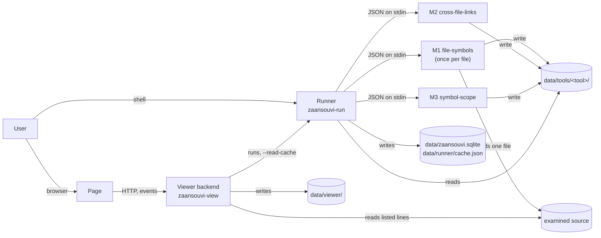

# 98. First implementation

> **[Superseded]** on 2026-11-09 by `97_second_implementation.md`, the MVP's main working file from then on. Kept as the record of the first stage (2026-11-07 to 2026-11-09) and **no longer updated**; where it and `97` differ, `97` is current.

What was built for the MVP, from the requirements in this folder, between 2026-11-07 and 2026-11-08: the tool helper, the three tools, the Runner and the Viewer, with their checks. Each part points to the requirements it implements and to the findings that record the choices made while building it. The code is in `zaansouvi-mvp/`; how to install and run each part is in its own README.

The work was done in three sessions, with AI assistance; ~~the first two are logged in `zaansouvi-mvp/ailog/` (`CLAUDE.md`, "Session logs"). The third, which built M3 and the Viewer, is not logged yet.~~ all three are logged in `zaansouvi-mvp/ailog/` (`CLAUDE.md`, "Session logs"); the third, which built M3 and the Viewer, is `26-11-09 002101 …`. A fourth session (2026-11-09, `26-11-09 140634 …`, with its screenshots in the folder of the same name) refined the Viewer's page after using it (section 3.7).

## 1. Summary

| Part | Folder | Version | Implements | Checks | State |
|---|---|---|---|---|---|
| Shared library | `app/shared/` | | `--info`, event and cache types; the log format (`DATA-16`); file helpers | through the Runner and the Viewer | Done |
| Tool helper | `app/tool-helper/` | | `TOOL-01` to `TOOL-08`, `TOOL-43`, `TOOL-45`; `DATA-14` to `DATA-17` | through the three tools | Done |
| M1 `file-symbols` | `app/tools/file-symbols/` | 0.5.0 | `TOOL-10` to `TOOL-17`, `DATA-05` | `tests/m1/`: exact match, 88 broken-input checks | Done |
| M2 `cross-file-links` | `app/tools/cross-file-links/` | 0.2.0 | `TOOL-20` to `TOOL-24`, `DATA-06` | `tests/m2/`: exact match, 28 checks | Done |
| M3 `symbol-scope` | `app/tools/symbol-scope/` | 0.2.0 | `TOOL-30` to `TOOL-36`, `DATA-07` | `tests/m3/`: exact match, `TEST-06`, `TEST-07`, 44 checks | Done |
| Runner `zaansouvi-run` | `app/runner/` | 0.1.0 | `03_runner.md`, `RUN-01` to `RUN-32` | `tests/runner/` (by hand), `TEST-08` | Done; automatic tests not written |
| Viewer `zaansouvi-view` | `app/viewer/` | 0.1.0 | `05_viewer.md`, `50_viewer_ui.md`, `55_viewer_backend.md` | `tests/viewer/`: `TEST-09`, `TEST-10` (32 checks) | Done; human review (P3) pending |
| Static preview of the page | `app/viewer/ui/preview.html` | | `UI-80`, `UI-81` | rendered in headless Firefox | Done |

About 4,800 lines of TypeScript, HTML and CSS in `app/`, and Cytoscape 3.34.4 as the only dependency added at run time. Everything runs on Node 22.23.1 with TypeScript run directly (Node's type stripping), except the page, which `tsc` compiles (`BE-90`).

## 2. How the parts fit



The rules the picture follows: tools know nothing of each other and receive only the records they ask for (`toolset.md`, section 2; `RUN-19`); the Runner knows tools only through `--info` (`RUN-25`); the Viewer uses only the Runner's output (`VIEW-03`, `viewer.md`, section 3.1) and has no tool-specific code (`VIEW-14`).

## 3. The parts

### 3.1 Tool helper and shared library

- **The tool helper** (`app/tool-helper/tool.ts`) carries the whole contract every tool shares, with no tool-specific code (`TOOL-45`, `ARCH-02`): command-line options, JSON on `--stdin` or `--json`, `last_run.json` as a complete input only (`TOOL-02`, `DATA-15`), the generic shape check from `--info` (`TOOL-03`), invocation and run errors with their exit codes (`04_tools.md`, error codes; `E1` to `E14`), the dry run that writes nothing (`TOOL-06`, `DATA-17`), atomic writes (`TOOL-05`), the log (`DATA-16`) and `result.json` (`DATA-14`). A tool supplies only its `--info`, its own shape checks and its work.
- **Since 2026-11-08** (`FND-59`): with no store given, the store is `./zaansouvi/tools/<tool>/` in the working folder; `last_run.json` lives in the store and doesn't record it; a tool given a `source_root` refuses to run from inside it (`E14`). Program folders are never written.
- **The shared library** (`app/shared/`) is used by the Runner and the Viewer backend, never by tools: the types of `--info`, events and the cache; the log writer and reader; `writeAtomic`, `readJson`, `canonicalJson`.

### 3.2 M1 `file-symbols` 0.5.0

Reads one TypeScript file with the TypeScript compiler's parser (`MVP-7`, `01_architecture.md`, technology table) and outputs its symbols and references (`TOOL-10` to `TOOL-17`, `DATA-05`): stable IDs (`DATA-02`), each symbol's `location` and `range` (`FND-09`), each reference's `from` (the enclosing function, or the file) and `to` (`FND-02`). Syntax errors are a run error, found through the compiler's syntactic diagnostics (`TOOL-10`, `FND-15`). Its notes go in `result.json`, never in the output (`FND-53`). Built in the first session; moved onto the tool helper in 0.4.0 with no change in behavior (`FND-48`).

### 3.3 M2 `cross-file-links` 0.2.0

Links each import to the declaration it imports, and each use of an imported name to that declaration (`TOOL-20` to `TOOL-24`, `DATA-06`). Reads no files: only M1's symbol and reference records (`DATA-13`, `RUN-19`). An unresolved import is a link with `to: null` and a reason, not an error (`FND-42`). Its parameter was renamed `symbols` in 0.2.0 (`FND-49`). Built 2026-11-08 (`FND-48`).

### 3.4 M3 `symbol-scope` 0.2.0

Groups each file's symbols into lexical scopes: the file scope and one scope per top-level function, each naming its owner (`TOOL-30` to `TOOL-36`, `DATA-07`; `MVP-4`, option C with C1, `FND-55`). Reads only M1's symbols. 0.2.0 orders its memberships independently of the input order (`TOOL-35`, `FND-58`). Built 2026-11-08 (`FND-57`).

### 3.5 Runner `zaansouvi-run` 0.1.0

Implements `03_runner.md` (`FND-43` records the choices made while building it):
- **finding tools and their order** from their `--info` alone, with no code for any tool (`RUN-05`, `RUN-25`); M3 was added later with no change to the Runner (`FND-57`);
- **the file list**, sorted by file ID (`RUN-06`, `RUN-28`), and the data no tool produces, such as `source_root` and the stores (`RUN-29`, `RUN-26`);
- **a dry run, then a real run, of each invocation that needs it**: the refresh check with an input fingerprint (`RUN-17` to `RUN-22`), the shape check of earlier outputs (`RUN-18`), each tool's input built from only the records it asks for (`RUN-19`);
- **the database** (`node:sqlite`, one file, `config_` and `project_` tables; `ARCH-10`), **the cache** that `--read-cache` prints (`RUN-13`, `RUN-27`), **the lock** (`RUN-30`), **events** on standard output, and its log;
- **tools started in its data folder** (`RUN-32`), so a Runner started inside the examined source still never runs a tool there.

### 3.6 Viewer backend `zaansouvi-view` 0.1.0

Implements `05_viewer.md` and `55_viewer_backend.md` (built 2026-11-08, `FND-69`; what changed during the build is in `55_viewer_backend.md`, section 15):
- **started by hand**, prints the URL with a one-time token, runs until stopped (`VIEW-07`, `BE-10` to `BE-14`);
- **the graph model** (`server/src/model.ts`): the generic checks (`VIEW-15`, `BE-60`), containment and owners, and the lifting of edges to every level, precomputed for each enterable node (`VIEW-13`, `BE-50` to `BE-54`); pure, so the same cache gives the same bytes;
- **its own store**, `data/viewer/`: one cache entry per examined source, valid graphs only, and the activity log (`VIEW-06`, `VIEW-08`, `VIEW-09`, `VIEW-16`, `VIEW-17`; `FND-61` to `FND-64`, `FND-66`);
- **the endpoints, the live stream and security** of `55_viewer_backend.md`, sections 8 and 9: the token turned into a session cookie, `Host` and `Origin` checks, a strict content security policy, reads limited by real path to the source's listed files and to `data/` (`VIEW-18`, `FND-68`);
- **the Runner** called with an argument array (`ARCH-03`, `BE-40`), one run at a time (`VIEW-05`).

### 3.7 The page

Implements `50_viewer_ui.md`: the header with the source picker and **Run** and **Dry run** (`UI-20` to `UI-23`); the graph with three levels, the breadcrumb, double-click to go in, selection (`UI-30` to `UI-36`); the visual key by data name and kind, a color per file (`UI-40` to `UI-43`); the drawer's Details, Tools, Problems and Legend tabs, with source lines (`UI-50` to `UI-55`); the status bar (`UI-60`, `UI-61`); the activity line with level toggles and Clear (`UI-62` to `UI-72`); the page's states (section 8). Everything shown is set as text, never as HTML (`VIEW-40`). A scope's members are listed in its label rather than nested in it (`BE-104`). Added on 2026-11-09 after using it (`FND-71` to `FND-73`): a color key naming the file behind each color (`UI-44`); a predictable layout, each node starting from its own place (`UI-32`); and, when a scope is entered, a frame labeled with the scope holding everything declared in it, its contents on a grid and the stubs around it (`UI-37`), which the user judged to improve readability. Added later that day (`FND-71`): the edges of a selected node drawn in the selection color, back to their own when it is unselected (`UI-38`); several selected items, by shift- or ctrl-click, all shown in Details, grouped by node (`UI-56`); a small triangle on every node that can be entered (`UI-45`); a Text button (zoom to 100%) and the current zoom beside Fit (`UI-46`); in Problems, each row led by its name, and unresolved relations grouped by name, for this view or all (`UI-54`, `UI-57`); Tools as boxes of the same kind, with "not run" for tools a failed run never reached (`UI-58`).

### 3.8 On disk

As in `01_architecture.md`, "Layout on disk": programs in `app/`, never written while running; all state in `data/` (`ARCH-09`): the database, `runner/` (cache, logs, lock), `tools/<tool>/` (each store, with its `last_run.json`), `viewer/` (sources, cached graphs, activity log). Clearing the Runner's and the tools' data leaves the Viewer's (`VIEW-09`).

## 4. Checks and their results

All pass, last run on 2026-11-08, from `zaansouvi-mvp/`:

| Check | Covers | Result |
|---|---|---|
| `node tests/m1/check.mjs`, `bash tests/m1/broken.sh` | M1 against `expected/file-symbols.json`; `B1` to `B7` and extras, including a copied store (`X11`) and `E14` (`X12`) | match; 88 of 88 |
| `node tests/m2/check.mjs`, `bash tests/m2/broken.sh` | M2 against `expected/cross-file-links.json`; `B8`, `B9`, unresolved cases | match; 28 of 28 |
| `node tests/m3/check.mjs`, `bash tests/m3/broken.sh` | `TEST-06`, `TEST-07`; `B11` to `B15` | match; 44 of 44 |
| `bash tests/hand-run/hand-run.sh` | `TEST-08`: the tools run by a plain script, files in reverse order, give byte-identical outputs to the Runner's (`FND-58`) | pass |
| `node tests/runner/compare-expected.mjs` (by hand) | A fresh full run and a second run against `expected/` (`TEST-01`, `TEST-05` in substance) | all 13 parts match (`FND-57`, `FND-59`) |
| `node tests/viewer/check-model.mjs` | `TEST-09`: the model's views against `expected/graph-views.json`; byte-identical builds; six damaged caches | pass |
| `node tests/viewer/check-server.mjs` | `TEST-10`: security, reads, the activity log, runs, bad data across restarts | 32 of 32 |
| The page in headless Firefox | Levels 1 to 3, an edge's details with source lines, Problems, the activity line; the strict security policy | as specified (`FND-69`) |

## 5. What changed while implementing

The build tested the requirements as much as it followed them. The main changes, each recorded where it belongs:

- **Contracts held, with refinements:** diagnostics moved out of output files into `result.json` (`FND-53`); keys renamed to keep one meaning per name (`FND-40`, `FND-49`; the reference schema, `DATA-20`); records carry `from` and `to` everywhere (`FND-02`).
- **Principles recorded in the working files from what the build showed:** each tool depends on as little as possible from other tools' outputs; the Runner can be replaced by a user's scripts; a tool's output never depends on the order of its input; unknown keys never change it (`toolset.md`, section 2; `FND-58`).
- **Where state lives:** the default store moved to the working folder, `last_run.json` into the store, and `E14` was added (`toolset.md`, sections 4.5 and 4.6; `FND-59`).
- **The Viewer's own design, settled while building it:** its own store (`FND-61`), switching sources without a restart (`FND-63`), checking every run's output and surviving bad data (`FND-64`), the activity log (`FND-66`), the backend's contract (`FND-68`).
- **Found by using it** (2026-11-09): the layout came out differently on every entry, and a symbol owning a scope looked unrelated to the view it was in. Fixed with a predictable starting layout and a frame for the scope being viewed; layout design noted as a subject to explore after the MVP (`FND-72`, `FND-73`). ~~Four more observations are open: arrow direction, edge labels, selecting several items, a dropdown in the breadcrumb (`FND-71`).~~ Four more observations, decided later that day (`FND-71`): selecting several items built, and the edges of a selected node highlighted instead of edge labels; arrow direction and more explicit navigation with search noted for after the MVP (`VW-40`, `VW-41`).
- **Found by the checks:** M3 depended on input order (`FND-58`); a missing edge in a hand-written level table, found by the model (`FND-69`); parameter properties refused by Node's type stripping (`BE-103`).

## 6. Against the MVP's success criteria

From `MVP_scope.md`, section 7, and `07_delivery.md`, the findings note:

1. **One command runs the Runner, M1 for every file, then M2, then M3, and leaves the data the Viewer needs (P2):** yes. `zaansouvi-run <source-root>`; the cache holds every data name.
2. **The output matches the expected result (P2):** yes, exactly, for every tool and for the Runner's events and cache.
3. **The Viewer starts the Runner, shows at least two levels and moves between them, shows symbols, references, links and scopes, and every element leads back to its file and line (P1, P3):** built and checked by script and in a headless browser; **the human review is still to do**.
4. **A broken input gives a clear no-go, which the Runner reports and the Viewer shows (P1):** the tools and the Runner, yes (`B6`, `B7`); the Viewer shows a failed run's reason and keeps the last good graph (checked in `TEST-10`), but `B7` through the page itself has not been tried.
5. **A dry-run-only pass reports go for every tool and no tool writes anything (P1):** yes (`FND-51`).
6. **A run without M3 still shows a graph with one level fewer (P1, P3):** not tried yet (`C1`). The Runner finds tools from `--info` and the Viewer has no tool-specific code, so it is expected to hold.

**Early P4 evidence** (`07_delivery.md`, item 2): M3 was added with no change to the Runner (`FND-57`); the Viewer's code names no tool, and uses data names only to pick a style (`VIEW-14`, `UI-41`): scopes and files are recognized by their roles (an owner, no container). Checking this while writing this file found four places that worded labels by the data name `code.scope`; they were made generic (`BE-109`, `FND-70`). A plain script can replace the Runner (`TEST-08`).

**Not yet measured:** timings (`07_delivery.md`, item 5; `MVP_scope.md`, section 8.1 holds the earlier measurements).

## 7. Not implemented, or still open

- The human review of the page (P3), and `C1` (a run without M3) and `B7` through the page.
- The automatic Runner tests `TEST-01` to `TEST-05` and `R1` to `R8` as scripts; they were run by hand (`tests/runner/README.md`).
- To decide: whether record keys the Viewer doesn't read count as extra data (`FND-69`, item 2); `FND-60`, items 6 and 7; `FND-56`; `MVP-8`.
- Out of the MVP, as decided: saved positions, the config manager, cancelling runs, starting the Viewer from the file manager or a shortcut, a desktop window (`55_viewer_backend.md`, section 13; `50_viewer_ui.md`, section 10).

## 8. Trying it

From `zaansouvi-mvp/`:

```
app/runner/zaansouvi-run test-source       # a real run of the three tools
app/viewer/zaansouvi-view                  # then open the printed URL
```

Each part's README has the details: `app/tool-helper/README.md`, `app/tools/<tool>/README.md`, `app/runner/README.md`, `app/viewer/README.md`.
