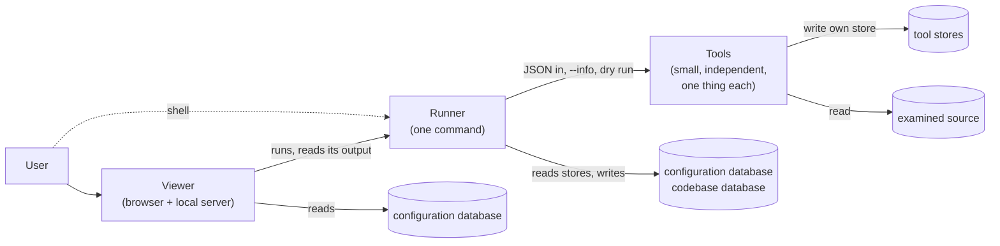

# ZaAnSouVi: where the design stands

> **Summary, written 2026-11-10.** This file summarizes the **product design** in the working files at the root of this folder: what it attempts, what is settled, what the MVP changed in it, what was superseded, and what is open. Nothing here decides anything; every line points to where it is recorded. The two MVP stages are summarized apart, in `../mvp_docs/summary/` (`00_where_we_are.md`, `10_mvp1.md`, `20_mvp2.md`).

## 1. What ZaAnSouVi is

**ZaAnSouVi**, "Zaida's Analysis of Source and Viewer", is a proposed toolset that analyzes **TypeScript codebases** and shows how the code relates at every level: symbols, modules, infrastructure (`toolset.md`, 1). Its main part is the **Viewer**, an interactive node graph in the browser backed by a local server, which is also the entry point. The tools also produce static Mermaid diagrams. It analyzes only the current state of the code, never its history, statically, and never runs the examined code (`security.md`, 1).

**The central question** for the deliverable: **can a tool-based source code visualizer be implemented?** The MVP is the first evidence (`MVP_scope.md`, 1.1).

## 2. What the design attempts

**Two principles** (`toolset.md`, 2):
- **"Each tool does one thing well."** A set of small, separate command-line tools, not one program.
- **"Be generous with what the tool accepts and careful with what the tool outputs."** Generous with variation in the input, such as partial projects, odd configs and settings from anywhere. Careful means output that is strict, stable, documented and machine-readable. Generosity is not tolerance of errors: a real run fails early.

**Rules that follow** (`toolset.md`, 2, [Decided]):
- static analysis only, and no redaction;
- a tool's inside doesn't matter, only its contract;
- tools are easy to replace and depend as little as possible on each other's outputs;
- the Runner can be replaced by the user's own scripts;
- a tool's output never depends on input order, and unknown keys never change it;
- for the product, repeatability, consistency and specificity are what matter.

**The hard problems** (`toolset.md`, 9):
1. readability of large graphs, with layout as the main lever;
2. dynamic imports and untyped references;
3. path aliases and project references;
4. infrastructure that TypeScript alone can't show;
5. performance on large monorepos.

## 3. What is settled

The main [Decided] points, by part. Each working file holds the rest.

**Tools** (`toolset.md`, 4):
- **Contract:**
  - JSON or plain text in and out, in per-tool folders;
  - every tool describes itself with `--info`, with no manifest (`data_topology.md`, `DT-1`);
  - each tool works with no configuration, and has the same common options as the others;
  - a dry run never writes anything; that rule binds the tools only, not the Runner or the Viewer.
- **Reading:**
  - a tool reads **one file per invocation**, of **one file type**, given by its file patterns;
  - **program tools** are the exception: every listed file of their type in one invocation (`TS-37`, from MVP 2);
  - a tool reading files declares `source_root`.
- **Writing:**
  - each tool writes only its own store and never reads the database;
  - it fails early and never writes partial data;
  - `last_run.json` lives in the store, and the default store is in the working folder;
  - a tool never runs from inside the examined source (`E14`).

**Runner** (`runner.md`):
- **What it is:** one command with defaults, written in TypeScript as a unit with the Viewer; tools may be on any stack.
- **Order:** the order of the tools is the Runner's job alone, derived from `--info` and kept in the configuration database. Files are handled sorted by file ID.
- **Inputs:** it gives each tool only the records of the data names it asks for, and the data no tool produces.
- **Running:** one run at a time, under a lock. It owns the file list.
- **Outputs:** it checks shape, not content; it keeps one cache per run configuration, which the Viewer prefers to read.

**Data** (`toolset.md`, 5):
- **Two databases:** a configuration database shared with the Viewer's backend, and one codebase database per codebase that only the Runner reads or writes.
- **What goes in them:** tool-specific work data never goes in a database.
- **Runs:** each run is one snapshot of the current state. The first run produces everything; later runs touch only what changed, detected by content hashes, without git.

**Viewer** (`viewer.md`):
- **What it is:** a TypeScript and HTML app with a local server. It is offline-capable and independent of the tools, and gets codebase data only through the Runner.
- **Runs:** none start automatically. A failed run keeps the last good graph showing, and a dry run never affects the graph.
- **The graph:**
  - one common graph model, with a level hierarchy defined by the app;
  - level 1 is the overview, and level 2 shows configuration, directory structure and known outputs;
  - a concept looks the same in every view;
  - every element traces back to file and line;
  - **layout is central to readability** (2026-11-09).
- **Data:** it checks all data itself and survives bad data. Partly malformed output becomes a pending version that the user approves.

**Security** (`security.md`), a later step:
- nothing runs the examined code;
- detectors only read;
- program folders are never written;
- only the Runner installs tools.

## 4. What the MVP showed about the design

The MVP tested the design in two stages; details in `../mvp_docs/summary/`.

**Held up in practice:**
- **Self-describing tools with `--info` and no manifest.** The Runner took on new tools with no code change (MVP 1).
- **Independent tools behind a stable contract.** The contract held for a very different tool, a whole-program `ts-program` (MVP 2).
- **A replaceable Runner.** A plain script gave byte-identical outputs to the Runner's.
- **Refreshing only what changed.** Running every tool on every run proved unnecessary, since the same input gives the same output. In the user's judgement (2026-11-10), a single snapshot is enough for most cases, assuming the examined source doesn't change too drastically in architecture or implementation.
- **The Viewer's own design:** its store, surviving bad data, its security model.
- **Speed on real code.** A full run on 6,000 lines took 4.4 s.

**Recorded in the working files because of the MVP** ([Decided] unless noted):
- **The data contract:**
  - tool outputs are meant for other programs too;
  - each tool depends minimally on the others;
  - the Runner can be replaced;
  - output doesn't depend on input order, and records nothing about the input it was given.
- **Reading and writing:**
  - `source_root` marks a tool that reads files;
  - file patterns in `--info`, one file type per tool;
  - `last_run.json` in the store, the default store in the working folder, and `E14`;
  - the dry-run rule binds the tools only.
- **Files and the Runner:**
  - the file list is the Runner's, and the file inventory comes first after the MVP;
  - files are sorted by file ID;
  - the Runner keeps a cache, and checks shape only.
- **The Viewer:**
  - it stays in the browser (`VW-38`, a desktop window, deferred);
  - it switches sources without a restart;
  - it checks every run's output;
  - layout is central to readability;
  - display controls go in the bottom-right corner.
- **Program tools** (`TS-37`): the exception to one file per invocation. MVP 1 showed TypeScript's checker needs the whole program to resolve across files (`FND-83`, `FND-84`), and MVP 2 built it.

**What it put in question:**
- **Hand-written analysis.** M1 to M3 worked on the test source and gave a wrong graph on real code. A tool should use the language's own compiler where one exists (MVP 1 → MVP 2).
- **Readability of large graphs**, hard problem 1, is confirmed as **the main design problem**. One file's view on real code had 110 nodes and 349 edges, and couldn't be read (`FND-99`, `VW-39`).
- **Packages without type declarations** leave much of the graph unresolved: only 69% of uses resolved on real code (`TPG-D8`). This touches hard problem 3 and `TS-11`.
- **P3 (the Viewer judged by a person) and P4 (independent tools are valuable)** are not answered yet. The human review is in progress, and P4's formal test comes after the MVP (`MVP_scope.md`, 10.1).

## 5. Superseded in the design

The main replacements, each struck through in place with the new wording beside it:

| Was | Now | Where |
|---|---|---|
| `last_run.json` next to the program; the program folder as default store | in the tool's store; default store `./zaansouvi/tools/<tool>/` | `toolset.md` 4.5, 4.6; `project_organization.md` 2–5 |
| Tools fall back to "sane defaults"; a damaged `last_run.json` falls back to defaults | repeat the last run or fail; defaults are the Runner's; damage is `E3` | `toolset.md` 4.5; `security.md` 7 |
| A missing parameter taken from a matching `last_run.json` | `last_run.json` only as a complete input | `toolset.md` 4.5 |
| Tools may read the database; each step writes its part | only the Runner reads or writes it | `toolset.md` 4.2, 5.2 |
| Tools assume their JSON is current and correct | each tool is responsible for correct output and fails on incongruences | `toolset.md` 4.2 |
| The file inventory records every file with kind and hash | the Runner owns the file list; the inventory gives kinds | `toolset.md` 6.2 (`RN-13`) |
| A tool reads one file per invocation, always | the same, except program tools | `toolset.md` 4.2 (`TS-37`) |
| A dry run may write temporary files | a dry run uses no temporary files | `toolset.md` 4.3 |
| The Viewer reads tool outputs and the database | it gets codebase data through the Runner | `viewer.md` 3.1 |
| A dry-run preview in the graph area | dropped | `viewer.md` 3.2 |
| Manifests (options B and C) | `--info`, no manifest | `data_topology.md` (`DT-1`) |
| The "global database" | the codebase database; "global" means the configuration database | `toolset.md` 5.2 |

## 6. What is open

About 80 open questions in the working files, plus 5 deferred. By theme, with IDs:

| Theme | Open questions | Where the MVP gives evidence |
|---|---|---|
| **Scope and languages** | `TS-1` more tools, `TS-4` and `TS-10` infrastructure, `TS-11` JavaScript, frameworks and monorepos, `TS-5` runtime data (`VW-18` merged into it), `VW-11` comparing two states, `TS-14` existing tools to reuse | `TS-11`: JavaScript and JSX out of MVP 2, packages are the gap (`TPG-D8`) |
| **Tool contracts** | `TS-2` code quotes, `TS-3` source links, `TS-22` JSON input against config, `TS-29` the Runner reading config, `TS-30` arguments without JSON, `TS-35` the shared library across stacks, `DT-2` to `DT-8` data names, containment, granularity, subsets, parents, inheritance, internal state | the MVP always sends JSON and reads no config files; containment comes from `parent` in MVP 2 |
| **Data and storage** | `TS-32` "all analysis details" in the database, `TS-33` the configuration database, `RN-12` what a value represents, `RN-16` staging, `RN-21` where the cache lives, `TS-12` paths across platforms, `TS-31` one process per file at scale, `TS-13` size and time targets | `TS-31`, `TS-13`: measured on 6,000 lines (`FND-99`) |
| **Runner behavior** | `RN-1` the listing, `RN-2` logs, `RN-3` a snapshot when a later tool fails, `RN-6` missing inputs, `RN-7` data from omitted tools, `RN-9` the Runner and the tool conventions, `RN-10` cancelled runs, `RN-11` dry-run data between tools, `RN-15` repeated runs, `RN-17` Viewer parameters, `RN-19` installing tools (deferred) | refresh only what changed: built and shown to work |
| **Viewer levels and navigation** | `VW-19` the full level hierarchy, `VW-20` several lower views, `VW-21` switching sideways, `VW-22` Ctrl + wheel, `VW-28` to `VW-32` what level 1 and 2 show, `VW-10` combined views, `VW-41` navigation and search (deferred) | MVP 2 goes to any depth by TypeScript's nesting |
| **Viewer UI** | `VW-2` malformed records, `VW-4` unresolved edges, `VW-14` showing differences, `VW-15` and `VW-16` colors and styles, `VW-17` arranging, `VW-23` status bar, `VW-24` status page, `VW-27` naming, `VW-35` the run configurations view, `VW-39` layout strategy (deferred), `VW-40` arrow direction (deferred) | `VW-39`: the main problem MVP 2 found; `VW-4`: MVP lists unresolved uses in Problems |
| **Viewer server** | `VW-6` codebases per server, `VW-8` source access, `VW-9` static export, `VW-38` desktop window (deferred) | the MVP serves the text a range covers |
| **Settings** | `TS-16` where global settings sit (`VW-26` merged into it), `TS-34` changing them from the command line (deferred), `RN-5` naming saved configurations, `RN-8` the Runner's configuration, `RN-18` human formats | |
| **Organization on disk** | `ORG-1` to `ORG-6`: the single root, where results and Runner configurations live, committed project config, finding the root, several users | the MVP uses one folder with `app/` and `data/` |
| **Security** | `SEC-2` links outside the project, `SEC-3` limits, `SEC-4` what an export leaves out, `SEC-5` runtime connections, `SEC-6` enforcing what a tool reads and writes | listing every file raised binary files and links outside the source (`security.md` 7) |
| **Planning** | `TS-6` which levels need which tools, `TS-15` phasing, `MVP-5` contracts kept, `MVP-8` success criteria | both MVP stages |

## 7. Cleanup done, and what is left

**Fixed on 2026-11-10**, each old wording struck beside the new in the working files:
- "one file per invocation" brought in line with program tools (`TS-37`) in `toolset.md`, `runner.md`, `data_topology.md` and `security.md`; "tools assume the stores are current" replaced by what `toolset.md` 4.2 now says;
- `viewer.md`: the Viewer gets the facts through the Runner and re-runs tools only through it; the section count; the misnested page list;
- `project_organization.md`: its header, and what tools and the Viewer may read, aligned with `toolset.md` 4.2 and `viewer.md` 3.1;
- questions: `MVP-4` struck; `TS-34` deferred; `RN-19` in number order; `VW-18` merged into `TS-5`, `VW-26` into `TS-16`;
- `MVP_scope.md`: a note at the top that it takes in the implementation's findings and that some original assumptions no longer stand, to review for the feasibility document (`DOC-5`); section 8.1 cites the questions it answers instead of restating them; section 7's counts; the split bullet in 1.2; section 2 labelled as MVP 1;
- `file_tree.md` deleted (kept in `mvp_docs/mvp_2026-11-10_before_cleanup.zip`).

**Left as they are, already open as questions:** `toolset.md` line 331, a [Decided] common library beside [Decided] "tools may run on any stack" (`TS-35`); line 79, "works with no configuration" beside tool config files (`TS-29`); `ORG-4` (tools reading a committed project config) against the direction of `TS-29`. The root files still cite MVP 1's findings as `mvp_docs/99_findings.md`, which now points onward to `mvp_docs/mvp1/99_findings_mvp1.md`.

## 8. What can be done next

1. **The rest of the cleanup**: the places marked *To update for MVP 2* in the MVP docs (`../mvp_docs/summary/20_mvp2.md`, section 12).
2. **Finish MVP 2**: the human review (P3) and the findings note. These feed `MVP-5`, `MVP-8` and P1 to P4.
3. **Bring the MVP's evidence into the product questions** it touches: `VW-39` (layout), `TS-11` and `TPG-D8` (packages), `TS-13` and `TS-31` (scale), and repeatability (`MVP_scope.md` 10.3), with the snapshot judgement of 2026-11-10.
4. **Decide the duplicated and overlapping questions together**: settings precedence (`TS-16`, `TS-22`, `TS-29`, `TS-33`, `RN-8`, `ORG-3`), runtime data (`TS-5`, `SEC-5`), staging (`RN-3`, `RN-16`).
5. **Then security** (`CLAUDE.md`, order of work), **then technology**, then `feasibility_and_execution_plan.md`.

## 9. The working files

Every question ID of these files, in order, with its current settled text only (the answer, what is settled and what is open, or the question), is in `00_definitions.md`, next to this file.

| File | Holds |
|---|---|
| `toolset.md` | scope, principles, traceability, the tool contract, shared data, every known tool, hard problems, `TS-` questions |
| `runner.md` | the Runner: run order, configurations, invoking tools, listing, log, failures, dry run, relation to the Viewer, `RN-` |
| `viewer.md` | the Viewer: server, pages, views, visual language, navigation, saving, cache, malformed data, `VW-` |
| `data_topology.md` | how data is described: the options weighed, `--info` chosen, containment, run order, `DT-` |
| `project_organization.md` | ZaAnSouVi's own files on disk, nothing decided of its own, `ORG-` |
| `MVP_scope.md` | the MVP: claims, both stages, scope, success criteria, post-MVP, `MVP-` |
| `security.md` | security concerns, a later step, `SEC-` |
