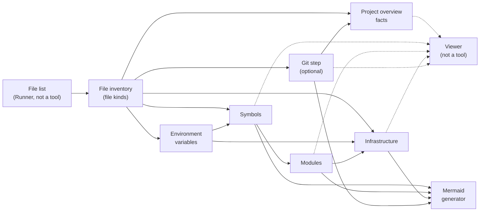

# ZaAnSouVi Toolset

Overview of the ZaAnSouVi toolset: its scope, the design rules every tool follows, the data the tools share, and every known tool at a high level. Specific details, such as formats, schemas, options and libraries, are left for a later step (section 11).

Each item is marked:
- **[Decided]**: agreed in discussion.
- **[Proposed]**: inferred from the decisions, to be confirmed or changed.
- **To define:** points the feasibility analysis must still work out.

Related files: `viewer.md` (the Viewer in detail) and `security.md` (security concerns, a later step).

## 1. Scope and audience

- **[Decided]** **The project as a whole must prove whether a tool-based source code visualizer can be implemented.** That is the central feasibility question. The MVP is the first evidence for it (`MVP_scope.md`, section 1.1).

- **[Decided]** ZaAnSouVi analyzes **TypeScript codebases** and shows how the code relates at every level:
  - **Symbols:** functions, classes, interfaces, types and variables, and how they reference, call, extend or implement each other.
  - **Modules:** files and packages, import and export graphs, and dependencies between packages in a monorepo.
  - **Infrastructure:** how code maps to deployable units and external systems, such as services, databases, queues, cloud resources and config.
- **[Decided]** Its main part is the Viewer, an interactive node graph viewer and the main entry point to the toolset (see `viewer.md`). The tools also produce static Mermaid diagrams for Markdown and documentation.
- **[Decided]** **Only ZaAnSouVi's own programs are in scope** for where things are stored and what gets written: the tools, the Runner and the Viewer defined in these files. Where outside programs (git, the language runtime, package managers, the browser) are installed and what they write is not a concern of this design.
- **[Decided]** **Current state only.** The toolset describes the code as it is now, on disk. Analyzing the project's history is an explicit non-goal: no co-change coupling, churn, ownership taken from history, or trends over time.
- **[Decided]** The output is for **developers who already know the examined codebase**. They expect technical detail and want to get from any element back to the source quickly.

## 2. Design principles

- **[Decided]** **"Each tool does one thing well."** The toolset is a set of small, separate command-line tools, each covering one aspect, not one monolith.
- **[Decided]** **"Be generous with what the tool accepts and careful with what the tool outputs."**
  - **Generous with variation in input:** partial projects, missing or odd TypeScript project configuration, mixed JS/TS, paths or globs, settings given on the command line or in config files.
  - **Careful with output:** strict, stable, documented and machine-readable, so the tools that read it later can rely on it.
- **[Decided]** Being generous applies to **variation**, not to **errors**. A real run fails early on errors that would make the result wrong, such as a missing output from an earlier tool or an unreadable file. The dry run is where such errors are found in advance (section 4).
- **[Decided]** **Static analysis only: nothing in ZaAnSouVi ever runs code from the examined source.** Tools only read files. The full list of what this rules out is in `security.md`, section 1.
- **[Decided]** The user may see every part of the examined source. Nothing is redacted.
- **[Decided]** **How a tool does its job is irrelevant, as long as its stated inputs and outputs are well defined and consistent.** A tool may read a file directly, or use any number of programs internal to it, including built-in shell commands such as `stat` or `file`, with proper wrapping and error checking.
- **[Decided]** **Tools are meant to be easy to replace.** That is part of why they only meet through the contract (parameters, `--info`, logs, outputs) and know nothing of each other (4.2, 5.5).
- **[Decided]** **For the product, what matters is repeatability, consistency and specificity of details.** The same inputs give the same outputs, every tool and view describes things the same way, and details are exact down to the location.
- **[Decided]** For the MVP, the only concern is whether this can work at all (`MVP_scope.md`, section 1).
- **[Proposed]** So a library or built-in feature is used in the product only where it meets those three demands; in the MVP, whenever it meets the requirement at all.
- **To define:** where the two principles conflict with other goals. For example, strict output against the many different inputs the tools accept.

## 3. Traceability

Traceability to the source at every step, made as easy as is reasonable, is a primary requirement, not a nice-to-have.

- **[Decided]** **Source locations travel through every stage.** Every symbol, edge, module and infrastructure item in every tool's output carries its file path and its start and end line and column. No tool may drop or blur a location it received.
- **[Decided]** **Clickable links** open the exact file and lines. They are built from a URL template in config: a repository host link, an editor link or a local path.
  - Links pin a ref (commit, tag or branch) when one is known, so they stay valid. The ref comes from config, or from the git step when git is present. With no ref and no git, links are local or editor links.
  - **A pinned link must show the code that was analyzed.** When the git step reports that a file has uncommitted changes or is untracked, a pinned link would show different code. Those files get local or editor links, or a marked link and a warning. A link that looks right but points at different content is never output.
- **[Decided]** **Code quotes:** reports next to the diagrams quote the relevant source for each node or edge, with its file:line.
- **[Decided]** **Static diagrams:** where a Mermaid diagram can't carry links and tooltips, companion output maps each node to its location, link and quote.
- **[Decided]** **Stable IDs:** each node gets an ID derived from its source. The same node has the same ID in every tool's records, every diagram and every report, and keeps it across runs.

## 4. What every tool has in common

### 4.1 Inputs, outputs and config
- **[Decided]** Each tool reads and writes **plain text or JSON**, whichever suits its inputs and outputs. **To define:** the format for each tool, with the reason.
- **[Decided]** Each tool writes its output to **its own files, in its own folder**, named after what it produces. Tools read earlier tools' outputs from those files, not through pipes, so each step can be inspected, cached and re-run on its own.
- **[Decided]** **Config is split by concern.** Each tool may have its own config file for settings only it uses. A project-wide config file holds only settings that cross tool boundaries, such as source root, output root, project ID, repository URL template and ref. **To define:** whether tool settings may also be written in the project-wide file, so a user can keep everything in one file.
- **[Decided]** **Command-line options are the same across all tools.** They are optional and override settings for that run:
  - one common set of options with the same names and meaning everywhere: source root, output root, project ID, config file path, ref, URL template, verbosity or diagnostics level, `--info` (4.1), `--log`, `--json` and `--stdin` (4.5)
  - tool-specific options follow the same naming pattern
  - the same help, version and exit-code behavior
- **[Decided]** Besides project-wide and tool config, there are **personal global settings** that apply to every codebase the user examines. They can be overridden per project. They are edited in the Viewer's config manager (`viewer.md`, section 4.11).
- **[Decided]** Precedence, from highest to lowest: command line, the tool's config file, the project-wide config file, built-in defaults.
- **[Proposed]** Global settings sit just above the built-in defaults: command line, tool config, project-wide config, global settings, built-in defaults. Any project setting then overrides a global one (`TS-16`).
- **[Decided]** **Every tool has an `--info` option** that describes the tool. Each tool is responsible for stating its own parameters and outputs. There is no manifest (`data_topology.md`, `DT-1`).
- **[Proposed]** The parameters `--info` states include the tool's settings (name, meaning, type, default), so the config manager can show and check the settings of the entire toolset without knowing each tool in advance.
- **[Decided]** Each tool declares the format of its own config. The Viewer's config manager writes each tool's config in that format (`viewer.md`, section 4.11).
- **[Decided]** Each tool works with **no configuration**, so one command can run everything.
- **[Proposed]** Since a tool invoked with no parameters repeats its last run or fails (4.5), "no configuration" now holds for the Runner: the one-command run works because the Runner builds every tool's parameters from its own sane defaults. Config files are read by the Runner, not by the tools (`TS-29`).
- **To define:** the common option set and its naming rules, how the runner passes common options to each tool, and how a run shows which source each setting came from, so the run can be explained and repeated.

### 4.2 Running
- **[Decided]** Each tool is **incremental**: it updates its outputs only when its inputs changed (section 5.3).
- **[Decided]** Tools run **one at a time**. No locking or concurrent writes are needed. The Runner takes a lock per run, so two runs never overlap; a tool run by hand is the user's action (`runner.md`, section 4).
- **[Decided]** Each codebase's data lives in its **own store**, so several codebases never overwrite each other (section 5.4).
- **[Decided]** **Each tool writes only to its own store.** Only the Runner writes to the database, based on the tools' outputs (5.2 and `runner.md`).
- **[Decided]** **The Runner checks a tool only through its input and its output**: the JSON it builds, the dry-run lines, the exit code, the result and the output's shape. It doesn't watch or limit what a tool reads or does.
- **[Decided]** **Tools never read the database.** A tool reads only its JSON input, its `last_run.json`, its internal state derived from the examined source and, if its `--info` says it reads files, the one file it is given. Reading the database is the Runner's responsibility. **A tool that needs to read more than one file, or the database, is a design error in that tool**, not something the Runner catches. (This replaces the earlier "reads from the database in the general case".)
- **[Decided]** **Only tools whose `--info` states that they read files or source read them.** Every other tool works from its JSON alone.
- **[Decided]** A tool that reads files **can have an optional parameter giving the actual path of the file it reads**.
- **[Decided]** **A tool reads only one file per invocation.** To cover many files, the Runner invokes the tool once per file.
- **[Decided]** **`source_root` is a known parameter, and declaring it marks a tool that reads files** (decided by the user on 2026-11-08). Every file path such a tool uses depends on it: it is resolved against `source_root`, and a tool can't read a file without it in its input.
- **[Decided]** **A tool that doesn't need file information**, one that never checks details of a real file, **makes that known in `--info`** (decided by the user on 2026-11-08), and doesn't take `source_root`.
- **[Proposed]** In `--info`, a tool that reads files states `readsFiles` with the file patterns it reads, and declares `source_root` as required; a tool that reads none states `"readsFiles": false`. The Runner refuses to start a tool whose `--info` says neither, or contradicts itself, and sends `source_root` only to tools that read files.
- **[Proposed]** A file path outside `source_root` is a run error for the tool that was given it.
- **[Proposed]** So the Runner, which isn't a tool, is the only program that reads many files in one go, for example when it lists the files (`runner.md`, section 1.1). Whether one process per file is fast enough on large codebases is a feasibility question (`TS-31`).
- **[Decided]** **Temporary files are used only for staging and for tool runs that need internal intermediate data to produce their outputs.** A JSON parameters file passed with `--json` may also sit in temp (4.5).
- **[Proposed]** A tool's intermediate data lives only for the run that needs it and is removed afterwards. Internal state kept between runs, such as caches, stays in the tool's own store (`data_topology.md`, section 4). The Runner's cache of a run's input, result and intermediate data is separate and the Runner's alone (`runner.md`, section 10.2).
- **[Decided]** **When run by the Runner, a tool receives its parameters as a JSON structure** with well-defined parameters: database values, file locations and all other relevant information (`runner.md`, section 1.1). How a tool gets its parameters is in 4.5.
- **[Decided]** **Each tool is unaware of the other tools.** It doesn't know which other tools exist or the order they run in. Working out the order is the Runner's job alone (`runner.md`).
- **[Decided]** **Each tool is responsible for producing correct output.** It checks its JSON and its own result as far as it needs to, and **fails if it finds incongruences** rather than output something wrong. (This replaces the earlier "All tools use their JSON as their source of truth. They assume the data in it is current and correct, make only a low effort to verify it where necessary".)
- **[Decided]** **Every tool has an optional `--log` option**, to redirect the log to another program or file (4.5). Every tool always writes its own log and its result in its own store.
- **[Proposed]** A tool knows the data it reads only by name (`data_topology.md`), never by the tool that produces it. Where this file says a tool "reads the symbol tool's output", the tool itself only knows it reads symbols.
- **[Decided]** **Only malformed or missing parameters are invocation errors.** **Incongruences are run errors, even when they are found while the tool checks its parameters.** (This replaces the earlier proposal that incongruences found during the parameter check are invocation errors.)
- **[Proposed]** The low-effort check covers what the tool needs in order not to produce wrong output: the **shape** of its parameters first, then their **values** (see "Data shape and data value" in 4.4). The Runner decides what is current before it starts a tool (`runner.md`), and a tool may check it too, since it is responsible for its output.
- **[Proposed]** The result a tool writes in its own store records at least: success or failure, the failure message, when it ran, the tool version and what it read. The Runner's log, its configuration listing and the Viewer read these results; the tool never reports to them directly.
- **[Proposed]** A user running a tool by hand gets the same log and output the Runner reads (4.5).

### 4.3 Dry run
- **[Decided]** Every tool has a **dry-run option**. A dry run does the tool's work but never changes the work data: no tool outputs, no codebase database, no Viewer cache. Results go to standard output.
- **[Decided]** **A dry run never writes a record to the file system or the database.** It can print all its data, including its result, to standard output, where the Runner reads it.
- **[Decided]** **These dry-run rules bind the tools only, not the Runner or the Viewer** (decided by the user on 2026-11-07). "No codebase database, no Viewer cache" above means a tool's dry run changes neither. The Runner and the Viewer may write whatever is useful during a dry run, including the database, their logs and their own data; the Runner may keep data of its own in the database and read it back to build a tool's JSON (`runner.md`, sections 5 and 9). What a dry run never changes is the work data, since no tool writes anything.
- **[Decided]** A dry run uses no temporary files: temporary files are only for staging and for tools' intermediate data in real runs (4.2). (This replaces the earlier "or to temporary files when that's needed".)
- **[Proposed]** When a dry run's log goes to standard output along with its data, the two are told apart the same way as in the Runner's log: data entries, and comment lines that start with a marker and carry a type or label (`runner.md`, section 7).
- **[Decided]** A dry run has three roles:
  - **Report:** what changed since the last saved run, such as changed files.
  - **Preview:** what a real run would produce: which outputs it would create, update or leave alone, and the results themselves.
  - **Status check:** it warns about **failures that can be prevented** before a real run, for example a missing output from an earlier tool, unreadable or missing files, an unknown schema version, or invalid config.
- **[Decided]** A dry run can be started from the Viewer.
- **[Proposed]** Temporary files from a dry run are kept outside the codebase's store and removed when no longer needed. A dry run prints where they are.
- **[Proposed]** The status check covers the same conditions a real run would fail on. A clean dry run means a real run on the same inputs should not fail for a reason that could have been prevented.
- **[Proposed]** How a dry run of the whole process works is in `runner.md`, section 9.

### 4.4 Failures
- **[Decided]** A **real run assumes its inputs are valid and fails early**. At the first error it stops with a clear diagnostic, instead of carrying on and producing doubtful output.
- **[Decided]** **A failing tool never writes partial data to its store.** Its earlier output stays as it was.
- **[Decided]** **If the data a tool reads isn't adequate for it, the tool fails with a clear message, written into its own store.** This is a run error: it applies once the tool has read its parameters correctly (4.5). An error in reading the parameters is an invocation error, which writes nothing.
- **[Decided]** **"Inputs not adequate" covers:**
  - **missing values** that the tool's declared inputs require
  - **values present but incorrect**
  - **values present and correct, but missing the tool-specific details** that each tool determines internally
  - **inputs that don't have the expected shape**, for example a string where an array is expected

  The full list of errors is in 4.6.

**Data shape and data value**

- **[Decided]** Two kinds of problem in a tool's inputs are kept apart:
  - **Data shape**: whether the data is there and has the expected form. A required value is present; it parses; it has the expected type and structure, for example an array and not a string.
  - **Data value**: whether the content is right, given a correct shape. A value is correct; values are consistent with each other and with the file read; the tool-specific details the tool determines internally can be found in them.
- **[Decided]** **In the parameters, only shape problems are invocation errors**: malformed or missing parameters. Nothing is written and nothing is logged (E1, E2, E3, E13).
- **[Decided]** **Value problems are always run errors**, including incongruences found while the tool checks its parameters. They are logged, and `last_run.json` is updated (E12).
- **[Proposed]** So the four cases of "inputs not adequate" sort as follows:

| Case | Kind | In the parameters | In the file read after the parameters |
|---|---|---|---|
| A required value is missing | shape | invocation error (E13) | run error (E12) |
| An input doesn't have the expected shape | shape | invocation error (E13) | run error (E12) |
| A value is present but incorrect | value | run error (E12) | run error (E12) |
| Values are correct but lack the tool-specific details | value | run error (E12) | run error (E12) |
| Values are incongruent with each other or with the file | value | run error (E12) | run error (E12) |

- **[Proposed]** Shape problems in the file the tool reads, for example a source file that doesn't parse, are run errors, because the parameters were already read correctly.
- **[Proposed]** The failure message is the tool's result record (4.2), not output. Writing it doesn't break the no-partial-data rule: the earlier output stays as it was, next to a result that says the latest run failed and why.
- **[Proposed]** A real run that fails leaves the work data as it was before the run: earlier outputs, the codebase database and the Viewer's last saved run are untouched. See `RN-3` for runs where an earlier tool already succeeded.
- **[Proposed]** The Runner's log is not work data. It is written even when a run fails (`runner.md`, section 7).
- **[Decided]** Failures to handle include disk read and write errors, missing files, files left incomplete by an earlier crash, files in the wrong format or with the wrong schema version, and outputs older than the source they describe. Each gives a clear diagnostic, never a crash or quietly wrong output.
- **[Proposed]** Since tools assume the stores are current (4.2), "outputs older than the source" is caught by the Runner and the dry run, not by the tools.
- **[Proposed]** Failures that can't be predicted, such as disk errors during a run, still make the real run fail early.
- The full list of known errors, their expected results and the files each one updates is in 4.6.

### 4.5 Parameters and logs
- **[Decided]** **A tool reads its parameters in this order:**
  1. **command-line arguments**, read first
  2. a JSON parameters input, given in one of two ways, **both in the same format**:
     - `--json <path>`: a JSON file, either in temp or at a specific path, for example in a different tool's store
     - `--stdin`: JSON generated by the calling app and passed on standard input
  3. if neither is given, **`last_run.json`**, which lives **in the same folder as the tool's program**: `tool_name/tool_name.bin` and `tool_name/last_run.json` (the `.bin` name stands for the tool's program on whatever stack it runs; how to start it is in the record of tools, `runner.md`, section 1.0)
  4. **a tool invoked with no parameters repeats exactly its last run, or fails.** If `last_run.json` is missing or unusable, the tool fails with an invocation error, writing nothing. Tools have no fallback to defaults of their own. (This replaces the earlier "sane defaults" step.)
- **[Proposed]** Sane defaults now belong to the Runner, which builds the parameters (`runner.md`, section 1).
- **[Decided]** **The Runner builds the JSON in memory**, as the tool requires it, and **checks that it is correct with a dry run**. The tool then **saves it to `last_run.json` once it is correct** (`runner.md`, section 1.1).
- **[Decided]** **The Runner reads and writes the database to build each tool's JSON parameters**, formatted according to what the tool states with `--info` (`data_topology.md`, `DT-1`).
- **[Decided]** **Every invocation must make sure it can create the JSON the tool requires.** If it can't, the tool is not started (see the Runner-bug rule below).
- **[Decided]** **A JSON input may contain all the required values and any number of extra, unused values.** A tool uses what it needs and ignores the rest; extra values are never an error.
- **[Decided]** What a tool needs from the database reaches it only as parameters; tools never read the database (4.2).
- **[Decided]** **Everything read as JSON is the tool's invocation parameters, wherever it comes from.** The tool makes no distinction in how it receives its parameters (command line, `--json`, `--stdin` or `last_run.json`) and deals only with the actual parameters.
- **[Proposed]** So data another tool produced, handed over with `--json <path>` into that tool's store, is parameters too. "Data" in the error rules (4.4, 4.6) then means only what the tool reads after its parameters: the examined source files and its internal state.
- **[Decided]** **`last_run.json` is updated on every run that is not a dry run, including failed runs.** Running the tool again with no changed data then fails again in the same way.
- **[Decided]** **The `last_run.json` rules above apply to every parameter that affects the output** (decided by the user on 2026-11-07).
- **[Decided]** **`last_run.json` is only ever used as a complete input**, never to fill in a single missing parameter (decided by the user on 2026-11-07).
- **[Decided]** **A parameter that doesn't affect the output may be optional in the input** (decided by the user on 2026-11-07). If it is missing, the tool uses its default, or works the value out from the input with its own capabilities, without affecting the Runner; if it can do neither, it fails early. **The same input always produces the same output.** (This replaces a decision earlier the same day that let a tool take a missing optional parameter from a matching `last_run.json`.)
- **[Decided]** **Where a tool writes its store is such a parameter** (decided by the user on 2026-11-07): it doesn't affect the output. It comes from the command line or the JSON input, or from `last_run.json` when that is the whole input; if the input lacks it, the tool writes its store in its own program folder, next to its program and `last_run.json` (`project_organization.md`, section 5).
- **[Proposed]** `--info` says, for each parameter, whether it affects the output, so a reader and the Runner know which parameters may be optional.
- **[Decided]** **If both `--json` and `--stdin` are given, the tool throws an error** saying the caller made a malformed invocation.
- **[Decided]** **An invocation that itself throws an error updates nothing.** `last_run.json` is updated only after the tool has validated that the run can begin: that it can work with its inputs and process the data. A failure after that point updates it.
- **[Decided]** **A tool that is unable to begin work does not log.** This covers a malformed invocation, and being invoked with no parameters and no usable `last_run.json`.
- **[Decided]** **No tool has Viewer-specific parameters.** Only the Runner may have them (`runner.md`, section 1).
- **[Decided]** **Only the tool's internal check of the parameters it reads is an invocation error.** If the tool reads the JSON and all required invocation parameters correctly, **any error further on in the run is a run error and is logged**. (This replaces the earlier "run failures count only once the data can be read and processing can begin".)
- **[Decided]** **If the Runner calls a tool without the parameters it needs to begin work and read its inputs, that is a bug in the Runner** (`runner.md`, section 4).
- **[Decided]** So two kinds of error are told apart:
  - **invocation errors**: found by the tool's internal check of the parameters it reads, such as a malformed invocation, an unusable explicit JSON input, no usable parameters at all, or parameters that are missing or malformed (a **shape** problem). Nothing is written: no `last_run.json`, no log, no result.
  - **run errors**: every **value** problem, including incongruences found while checking the parameters, and everything after the parameters have been read correctly, such as a file that can't be read, data that turns out to be inadequate, or a disk error. `last_run.json` is updated, the error is written to the tool's log and result in its store, and no partial output is written (4.4).
- **[Proposed]** An invocation error goes to the caller on standard error, with a non-zero exit code.
- **[Proposed]** A tool run by hand that hits an invocation error tells the user on standard error and exits; there is nothing to look up afterwards.
- **[Decided]** **Repeating a run is as simple as invoking the tool again**, by hand or from a UI that shows the user what failed and offers options to fix it (`viewer.md`, section 4.14).
- **[Decided]** **`--log` is optional.** It redirects the log to another program or a file.
- **[Decided]** **Every tool writes its own log, in the same format as the Runner's log** (`runner.md`, section 7): entries a parser reads, and comment lines that start with a marker and carry a type or label.
- **[Decided]** **After each tool run, the Runner reads the tool's log and the output it produced.**
- **[Decided]** **A dry run only writes to standard output.** It reads parameters the same way, but doesn't update `last_run.json` and doesn't write a log file.
- **[Proposed]** "Read first" means command-line arguments take precedence: a value given on the command line overrides the same value in the JSON input, which overrides `last_run.json`, which overrides the defaults.
- **[Proposed]** `last_run.json` holds the full, effective parameters of the last real run, in the same format as the JSON input. A tool started with no input then repeats its last real run, and a user can copy the file and pass it back with `--json`.
- **[Decided]** A tool invoked with no parameters and no usable `last_run.json` fails with an invocation error (E3). A JSON input given explicitly with `--json` or `--stdin` that is missing or malformed is an invocation error too (E2).
- **[Proposed]** `--json <path>` pointing into another tool's store lets the Runner hand a tool another tool's data without the tool knowing where it came from. This keeps tools unaware of each other (4.2).
- **[Proposed]** Each tool's log is kept in its own store, one file per real run, with a timestamp, like the Runner's.
- **[Proposed]** `--log` sends a copy of the log to the given program or file; the log in the tool's store is still written, since the Runner reads it after each run. If "redirect" means the store log is not written, the Runner must never pass `--log`.
- **[Proposed]** `last_run.json` also records the outcome of that run (succeeded or failed, and why), so the UI can show what failed next to the parameters that caused it.
- **To define:** where JSON input and `last_run.json` sit in the precedence order of config files and global settings (`TS-22`), and how `last_run.json` next to the program fits isolation between codebases (`TS-25`).

### 4.6 Known errors and what they update

What a tool does for each known kind of error, and which files it updates. "Store" means the tool's store for the codebase being examined; `last_run.json` sits next to the tool's program (4.5). Tools never write to the database (5.2), so it appears in no row.

Errors fall into three groups:
- **Invocation errors** (E1, E2, E3, E13): found by the tool's internal check of the parameters it reads. It writes nothing and doesn't log ([Decided], 4.5).
- **Run errors** (E5, E6, E8, E12): the parameters were read correctly; anything that goes wrong after that. The tool logs the error and updates `last_run.json`, but writes no partial output ([Decided], 4.4 and 4.5).
- **Not failures** (E7, E9): the run goes on, with a note in the log.

E10 (interrupted) and E11 (dry run) are handled separately.

**Kinds of error**

| # | Group | Kind | Examples | Expected result | Status |
|---|---|---|---|---|---|
| E1 | Invocation error | **Malformed invocation** | both `--json` and `--stdin`; unknown option; option value of the wrong type | Stops with an error saying the caller made a malformed invocation. | [Decided] for both `--json` and `--stdin` and for not logging; [Proposed] for the other examples |
| E2 | Invocation error | **Explicit JSON input unusable** | `--json` path missing or unreadable; JSON that doesn't parse | Stops with a clear message naming the file. | [Decided]: lacking the parameters to begin is a cannot-begin case |
| E3 | Invocation error | **No parameters and no usable `last_run.json`** | invoked with no parameters, and `last_run.json` is missing, unreadable or malformed | Stops without logging; the tool can't repeat a last run and has no defaults of its own. | [Decided] |
| E4 | — | ~~**No sane default**~~ | merged into E3: tools no longer fall back to defaults | — | [Decided] |
| E5 | Run error | **Inputs can't be read** | data the tool reads after its parameters (examined source files, its internal state) is missing, unreadable, in an unknown format or schema version | The run fails with a clear message naming the input. | [Decided]: after the parameters are read, every error is a run error |
| E6 | Run error | **The file to read is gone or unreadable** | the one file named in the parameters (4.2) is missing or can't be read when the tool opens it | The run fails with a clear message naming the file. | [Proposed] |
| E7 | Not a failure | **Limits reached** | a file too large, nesting too deep, too many files (`SEC-3`) | The item is skipped, the skip is recorded in the output and the log, and the run goes on. | [Proposed] |
| E8 | Run error | **Unexpected failure during processing** | disk read or write error, out of memory, a defect in the tool | The run fails. No partial output is written. | [Decided] |
| E9 | Not a failure | **Damaged internal state** | a cache or checkpoint in `state/` can't be read | The tool discards it, works from its inputs, and notes it in its log. | [Proposed] (`data_topology.md`, section 4) |
| E10 | — | **Interrupted or cancelled run** | the user cancels from the Viewer; the process is killed | No partial output may become current. What is left behind is `RN-10`. | [Proposed] |
| E11 | — | **Any error in a dry run** | any of the above during a dry run | Reported on standard output only. Nothing is written anywhere. | [Decided] |
| E12 | Run error | **Inputs not adequate** | **value** problems anywhere: (b) a value is present but incorrect; (c) values are present and correct but lack the tool-specific details the tool determines internally; (e) values are incongruent with each other or with the file read. **Shape** problems in the file read after the parameters: (a) a required value is missing; (d) the data doesn't have the expected shape. Data left incomplete by an earlier crash shows up as (a) or (d). | The run fails with a clear message naming the input, the value and the case. Earlier output stays as it was. | [Decided] |
| E13 | Invocation error | **Parameters malformed or missing** | **shape** problems in the parameters only: a required parameter is missing, or doesn't have the expected shape (for example a string instead of an array), as found by the tool's check of the parameters it reads. Extra, unused values are never an error. Value problems in the parameters are E12. | Stops with a clear message naming the parameter. When the Runner is the caller, this is a Runner bug, caught by its dry run. | [Decided] |

Not tool errors: **outputs older than the source** are caught by the Runner and the dry run, not by the tools (4.4).

**Files updated**

| Group | `last_run.json` | Log in store | Result in store | Output in store | `state/` | Standard output / error |
|---|---|---|---|---|---|---|
| Invocation errors (E1, E2, E3, E13) | no | no | no | no | no | the error, with a non-zero exit code |
| Run errors (E5, E6, E8, E12) | yes | yes | yes: failed, and why | no; earlier output kept | unchanged or discarded, never half-written | the error, with a non-zero exit code |
| Limits (E7) | yes | yes, listing skips | yes: succeeded, with skips | yes, marking the skipped items | as usual | log copy only if `--log` |
| Damaged state (E9) | yes | yes, with a note | yes | yes, if the run succeeds | rebuilt | log copy only if `--log` |
| Interrupted (E10) | yes, if processing had begun | as far as it got | `RN-10` | no partial output becomes current | `RN-10` | — |
| Dry run (E11) | no | no | no | no | no | everything, including the error |

- **[Decided]** An invocation error writes nothing and isn't logged (4.5).
- **[Decided]** Run errors update `last_run.json`, so running again with nothing changed fails again in the same way (4.5).
- **[Decided]** A failing tool never writes partial output (4.4).
- **[Decided]** When the Runner calls a tool and gets an invocation error, that is a bug in the Runner (`runner.md`, section 4).
- **[Proposed]** Each group has its own exit code, so the Runner can tell an invocation error from a run error without parsing messages. The codes themselves are deferred to the technology section.
- **[Proposed]** For an invocation error, the only record is the caller's: the Runner writes the error it got back into its own log, marked as a Runner bug.
- **[Proposed]** The UI shows each failure with its kind, its message, the parameters from `last_run.json` and the tool's log, so the user can see what failed and how to fix it (`viewer.md`, section 4.14). For an invocation error, it shows the Runner's log entry instead.

## 5. Shared data

### 5.1 Each tool owns its data
- **[Decided]** Each tool writes only its own data, about the thing it handles. A tool never parses something outside its job. When it needs to point at something outside its job, it reads the output of the tool that owns it and links to it. Example: the module tool doesn't parse symbols; it reads the symbol tool's output to link modules to the symbols they export. That output reaches it as parameters built by the Runner (4.5).
- **[Decided]** Each kind of thing is parsed once. The code model as a whole is the set of files the tools own.
- **To define:**
  - **Cross-references:** how one tool's records point to another's, using stable IDs, and what happens when the target isn't there.
  - **Run order:** moved to `runner.md` (section 2 and `RN-6`).
  - **Schema versions:** how each tool's output is versioned, and what a reader does with a version it doesn't know.
  - **Size:** file size and memory on large monorepos, for example splitting a tool's output by package.

### 5.2 Databases
- **[Decided]** **There are two databases:**
  - **the configuration database**: one for ZaAnSouVi as a whole, holding its global configuration, such as the date format and the preferred output
  - **the codebase database**: one per examined source, holding things like the file list and all analysis details. It is **never shared between analyses**.
- **[Proposed]** "Codebase database" is the new name for what these files called the "global database" until now: it was "global" only in the sense of facts that cross tools within one codebase. "Global" now refers only to ZaAnSouVi-wide configuration.

#### The configuration database
- **[Decided]** Holds ZaAnSouVi's global configuration, for example the `--human` date format and the preferred output (`runner.md`, section 10.1).
- **[Decided]** May hold the **record of available tools**, and is **the source of the ordering** of tools, derived from each tool's `--info` (`runner.md`, sections 1.0 and 2).
- **[Proposed]** It is where the personal global settings (4.1) live, rather than in a settings file. Whether it holds all of them is `TS-33`.
- **[Decided]** **It is shared by the Runner and the Viewer's backend.** The backend may edit it directly.
- **[Decided]** **The Runner and the Viewer must stay in sync on it as part of development**: they agree on its structure and meaning, and are changed together.
- **Pending:** how to change ZaAnSouVi's global settings from the command line is not defined yet (`TS-34`). Not in the MVP's scope.
- **[Decided]** So the configuration database carries a structure version. The Runner and the Viewer each check it on start and fail early with a clear message if they don't recognize it, rather than misread a setting.
- **[Decided]** The Runner reads the configuration once, when a run starts. A change the Viewer makes during a run applies from the next run, so one run never mixes two configurations.
- **[Decided]** Tools never read the configuration database, like the codebase database; what they need reaches them as parameters (4.2).
- **[Proposed]** It holds no data about any examined codebase, so it can be shared across analyses without breaking isolation (5.4).

#### The codebase database
- **[Decided]** One SQLite database per codebase holds **global facts that rarely change** and don't depend on what any single tool needs:
  - environment variables: names, where each is defined and where it is read
  - the file list: paths and content hashes, provided by the Runner, which drive change detection; and each file's kind, from the file inventory tool (6.2)
  - git facts, only when the git step found a repository
  - which tool outputs exist, their schema versions and the state of the file list they were built from
- **[Decided]** **Only the Runner reads the database.** Tools never read it; the facts they need reach them as parameters built by the Runner (4.2, 4.5). (This replaces the earlier "every tool may read it".)
- **[Decided]** **Only the Runner writes to the database**, based on the outputs of the tools. Tools never write to it. (This replaces the earlier rule that each step wrote its own part.)
- **[Proposed]** The facts still belong to the tool that produces them: the file inventory produces the file kinds, the git step the git facts, and so on. The file list itself is data no tool produces, provided by the Runner (`runner.md`, section 4). The Runner loads each tool's output into that tool's part of the database after the tool succeeds (`runner.md`, section 5).
- **[Proposed]** The record of which tool outputs exist, their schema versions and what they were built from is written by the Runner too.
- **[Decided]** The `--human` format configuration is not here: it is global configuration, in the configuration database (above).
- **[Decided]** The codebase database holds **all analysis details** of its codebase, and none of them are shared with other analyses. How this fits the next rule is `TS-32`.
- **[Decided]** **Tool-specific work data never goes in the database.** (The Runner decides per value what goes in the database, and reads work data from the tools' stores when a later tool needs it; `runner.md`, section 5.) It stays in each tool's own plain-text or JSON files, which keeps those outputs readable, comparable as text, and owned by one tool.
- **To define:** where the line falls between global and tool data, what the database holds and how its structure is versioned, which step fills which part, how it stays stable between runs and in sync with the source, and whether a text export is needed so the global facts can be read and compared.

### 5.3 Incremental runs
- **[Decided]** The first run on a codebase, with nothing saved yet, produces every output. Later runs change only the files and database rows affected by changes in the source. When nothing changed, a run writes nothing. This covers the work data: the Runner may still write the database whenever it's useful, for example its log and run record (decided by the user on 2026-11-07; `runner.md`, section 5).
- **[Decided]** **Tools write only current data.** A run overwrites a tool's work data with the current result. Tools keep no earlier versions of their outputs.
- **[Decided]** Each run treats the source as **one consistent snapshot**: all outputs from a run describe the same state of the code, never a mix of old and new.
- **[Decided]** Change detection is based on file contents recorded in the file list, plus config changes. It works without git. (The file list, with its content hashes, is now provided by the Runner, decided by the user on 2026-11-07; `runner.md`, section 4.)
- **To define:** how a change spreads to the tools that read the affected outputs, how leftovers such as records for deleted files are cleaned up, and how a run stays one snapshot if it is interrupted part way.

### 5.4 Isolation between codebases
- **[Proposed]** A layout on disk for stores, work spaces and the shared store is proposed in `project_organization.md` (undecided, `ORG-1`).
- **[Decided]** The toolset can examine many codebases without one overwriting another's data. Each codebase's internal files and codebase database live in their own folder, named from an **identity key**.
- **[Decided]** The key identifies the **codebase, not a commit**. Each codebase has one store, updated incrementally to its latest state, and the current ref is recorded inside it when known.
- **[Proposed]** The key comes from an explicit project ID in config, the project name, or a hash of identifying details such as root path and project name. A remote URL found by the git step can strengthen it.
- **To define:** the exact key; where the stores live (inside the examined project, under an output root, or in a user cache folder; how a tool learns its store is decided in 4.5) and how they relate to the final outputs; how stores of codebases no longer examined are listed and cleaned up; how forks, clones in different paths and monorepo sub-projects are told apart.

### 5.5 Shared library (not a tool)
- **[Decided]** Tools may run on any stack (`runner.md`, section 1.0), so a code library can't be shared by every tool. What all tools must share is the **contract**: the parameter, `--info`, log, `last_run.json` and output formats, defined independently of any language.
- **[Proposed]** A library for TypeScript tools can still implement that contract, as a convenience; tools on other stacks implement the same contract themselves (`TS-35`).
- **[Decided]** *(Earlier decision, now limited by the line above.)* A thin common library used by every tool. It reads, validates and writes tool outputs, and resolves references between outputs. Read access to the codebase database is for the Runner only, since tools never read it (4.2). It gives each tool only the parts of other tools' outputs that it asks for.
- **[Decided]** It contains no logic that belongs to a single tool. The TypeScript source is parsed only by the tools whose job needs it.
- **To define:** what the library gives (consistent IDs, locations, error handling) weighed against the coupling it adds between tools.

## 6. Known tools and programs

The analysis steps (6.2 to 6.9) are tools. The Runner (6.1) runs them, and the Viewer (6.10) is a separate program beside them, not a tool.

### 6.1 Runner
Full detail in `runner.md`.
- **[Decided]** Runs the full process with one command, using defaults. It alone works out which tools run and in what order, invokes them, and records each run in a timestamped log and a per-configuration listing.
- **[Decided]** Its run process: read the configuration, find the examined source, read all files and update the file list, decide the tools and their order, then for each tool send JSON parameters, read its output, possibly run it several times (including a dry run), and after the real run update the database before the next tool (`runner.md`, section 1.1).

### 6.2 File inventory
- **[Decided]** **The file list is the Runner's**: every file in the examined project, with its path and content hash, is data no tool produces, so the Runner provides it (`runner.md`, sections 1.1 and 4). Change detection is based on it (5.3). (This replaces the earlier "the file inventory records every file: path, kind and content hash"; `RN-13`.)
- **[Decided]** **The file inventory stays a tool, and determines what kind of file each input is**, using the tool's own heuristics: for example whether a file in the examined code is code, SQL or configuration (decided by the user on 2026-11-07).
- **[Decided]** **Its kinds improve the details the Runner and the Viewer have** (decided by the user on 2026-11-07). It writes them to its own store, and the Runner loads them into the codebase database (5.2).
- **[Decided]** Works without git. Ignore files and code-owner files are read as plain files, by whichever program needs them.
- **[Proposed]** Like every tool that reads files, it reads one file per invocation (4.2), so the Runner invokes it once per file in the list.
- **[Proposed]** It runs right after the Runner has listed the files, before the tools that read files, since the kinds can help the Runner match files to the tools that read them, beyond the file patterns each tool states in `--info`, and help the Viewer show and group files by kind.
- **[Proposed]** The Runner applies ignore files and include/exclude settings when it builds the file list, since deciding which files belong to the project is part of listing them.

### 6.3 Git step (optional)
- **[Decided]** The only step that deals with git. No other tool touches git. It runs only when a repository is present, and missing git is never an error.
- **[Decided]** Reads only the current state, never history. Its job is **traceability**: it connects the files on disk to where they are published, so links are correct. It adds no relations between code elements.
- **[Decided]** It records these facts, which the Runner loads into the codebase database (5.2):
  - **Link anchors:** the current commit, the remote and its host type for the link format, the repository root, and the examined project's sub-path, so links use repository-relative paths.
  - **Working-tree state:** which files have uncommitted changes or are untracked, which drives the pinned-link rule (section 3). Unusual states, such as a rebase or merge in progress, are reported as warnings.
  - **Submodules:** each one's path, remote and commit, for correct links. The module views may show them as boundaries.
  - **Files that are part of the project:** which files git tracks, and which it marks as generated or vendored, to refine the file list and the file kinds.
  - **Capability flags:** for example whether git, a remote or uncommitted changes are present. Other tools check these flags and use git facts only when they're there.
- **To define:** what is lost without git (mainly links pinned to a commit) and the fallbacks (a ref from config, local or editor links), and which wins when git facts and config disagree, for example on the ref or URL template.

### 6.4 Environment variables
- **[Decided]** Environment variables are global facts: names, where each is defined and where it is read. The step writes them to its own store, and the Runner loads them into the codebase database (5.2).
- **[Proposed]** A dedicated step owns these facts, because otherwise no step owns them.
- **[Proposed]** It records names and locations, and values where the source contains them. No redaction applies (see `security.md`, section 2).

### 6.5 Symbols
- **[Decided]** Records the symbols in the TypeScript code: functions, classes, interfaces, types and variables, and how they reference, call, extend or implement each other.
- **[Proposed]** Records each reference with its own location, and whether a variable reference reads or writes it. The Viewer's variables view needs this.
- **[Proposed]** Links symbols to global facts, such as the file a symbol is in and the env vars it reads.

### 6.6 Modules
- **[Decided]** Records files and packages, the import and export graph, and dependencies between packages in a monorepo.
- **[Decided]** Reads the symbol tool's output to link modules to the symbols they export, instead of parsing symbols itself. The tool knows only that it reads symbol data, not which tool wrote it, and receives it as parameters (4.2, 4.5).

### 6.7 Infrastructure
- **[Decided]** Records how the code maps to deployable units and external systems: services, databases, queues, cloud resources and config.
- **[Decided]** Infrastructure can't be inferred from TypeScript alone, so this step also reads infrastructure and config files.
- **[Proposed]** Feeds an infrastructure view in the Viewer, for example App → { database, server, renderer }. Where that view sits in the level hierarchy is not yet known (`viewer.md`, section 4.9.1).
- **[Decided]** **Runtime data of the examined codebase falls to a specific tool for each type of data.** For example, one tool reads SQLite details such as row counts, and another checks whether a file is of the SQLite type.
- **[Proposed]** These tools read data files found in the examined project, such as a SQLite file, one file per invocation (4.2). Reading a data file runs no code from the examined source. Connecting to a running database server is a different case, still open (`SEC-5`).
- **[Proposed]** Database details from the code, such as table names from schema definitions or migrations, may be a separate step, feeding the Viewer's database overview. Runtime details such as row counts are an open question (`TS-5`).

### 6.8 Project overview facts
The Viewer's level 1 and level 2 (`viewer.md`, section 4.9.1) need facts about the project that no tool above records yet.
- **[Proposed]** These steps, each doing one thing, contribute facts:
  - **Project configuration:** the project's manifest and configuration files, versions, and run configurations such as scripts.
  - **Known outputs:** what the project produces, for example a command-line tool, a website or a library, and where that is declared.
  - **Optional details:** small detectors that report whether something is present, for example AI assistant configuration, a known editor configuration, or git configuration (from the git step's capability flags).
- **[Proposed]** File count and the directory structure come from the Runner's file list, and the mix of file kinds from the file inventory (6.2). No new step is needed for them.
- **[Proposed]** Every fact has the same shape: category, name, value, and where it was found. A new detector adds facts without any change to the Viewer, which is what makes the overview extensible.
- **To define:** whether these facts live in the codebase database, since they are project-wide and rarely change, or in each step's own files.

### 6.9 Mermaid generator
- **[Decided]** Produces static Mermaid diagrams from the tool outputs, for use in Markdown and documentation.
- **[Decided]** Where a diagram can't carry links and tooltips, it produces companion output that maps each node to its location, link and quote.

### 6.10 Viewer
- **[Decided]** The main part of the toolset and its main entry point: a local server plus a browser UI. Users start runs and dry runs, follow them and explore the results from it.
- **[Decided]** **A separate program that runs beside the tools.** It is used to manage the tools' configuration, add tools to or omit them from the Runner's order, and list the known facts about the examined application and its data.
- **[Decided]** **Not a tool.** It is independent of the tool conventions and of the data topology. Like the Runner, it reads the stored facts as it needs them, and it has no place in the run order.
- **[Decided]** Can access every tool's output and all the data the tools have saved, never parses source and never writes other tools' outputs.
- **[Decided]** Reads the configuration database directly; gets codebase data through the Runner (`viewer.md`, section 3.1).
- **[Decided]** After each run, it re-reads what is relevant, according to the Runner's output for that run.
- **[Decided]** Writes tool configuration, in the format each tool declares (4.1).
- **[Decided]** Has internal storage of any kind for its own data: preferences, views, positions, UI state and the cache. It may keep its own cache or database through its backend, if required.
- **[Decided]** Calls the Runner with parameters useful for visualization, such as dry-run only and read cache (`runner.md`, section 10). The Runner and all tools share data through the Runner.
- Full detail in `viewer.md`.

## 7. How the tools depend on each other

- **[Proposed]** Arrows mean "is read by". The run order follows from them. Dotted arrows go to the Viewer, which reads but is not part of the run order (6.10).

## 8. Who owns which data

| Data | Owner | Kept in |
|---|---|---|
| File list and content hashes | Runner | Codebase database (`runner.md`, section 4) |
| File kinds (code, SQL, configuration and the like) | File inventory | Its own store; loaded into the codebase database by the Runner |
| Git facts and capability flags | Git step | Its own store; loaded into the codebase database by the Runner |
| Environment variables (names and locations) | Environment variables step | Its own store; loaded into the codebase database by the Runner |
| Which outputs exist, and their versions | Runner | Codebase database |
| Symbols and references | Symbols | Its own files |
| Modules, imports and exports | Modules | Its own files |
| Infrastructure items and their links to code | Infrastructure | Its own files |
| Project overview facts (configuration, versions, known outputs, optional details) | Project overview steps | To define (codebase database or own files) |
| Mermaid diagrams and companion output | Mermaid generator | Its own files |
| Viewer preferences, views, positions, UI state, cache | Viewer | Its internal storage, in any form |
| Tool configuration | Each tool declares its format; users edit it, also through the Viewer | Config files |

## 9. Hard problems to address

At the level of concepts, the analysis must address:
- readability of large graphs
- dynamic imports and untyped references, which hide relations from static analysis
- path aliases and project references
- infrastructure that can't be inferred from TypeScript alone
- performance on large monorepos

## 10. Open questions

- `TS-1` **Missing tools** *(partly answered: the project overview steps in section 6.8; one tool per type of runtime data, such as SQLite details or file type checks, section 6.7)*: are there more tools not yet listed? Candidates: a database schema step, or one per kind of infrastructure source.
- `TS-2` **Code quotes:** which step extracts the code quotes? Each tool for its own records, the shared library, or a separate step?
- `TS-3` **Links:** where are source links built? In the Viewer and the Mermaid generator when they display them, or by one step that writes them out for both?
- `TS-4` **Infrastructure as one step or several:** one step for all infrastructure sources, or one per kind of source (deployment files, cloud definitions, container definitions)?
- `TS-5` **Runtime data** *(partly answered: each type of runtime data falls to its own tool, for example SQLite row counts read from a SQLite file in the project, section 6.7)*: is reading from a running database or service, rather than from files in the project, in scope? Same question as `VW-18`.
- `TS-6` **Which levels need which tools** *(partly answered: levels 1 and 2 need the project overview steps, section 6.8)*: the rest of the Viewer's level hierarchy (`VW-19`) decides which further tools must exist.
- `TS-7` ~~**Dry run in the Viewer**~~: resolved. The Viewer can start a dry run and shows its result (see `viewer.md`, section 3.2).
- `TS-8` ~~**Standard output or temporary files**~~: resolved. A dry run prints everything to standard output and uses no temporary files (section 4.3).
- `TS-9` ~~**Implementation stack**~~: resolved. The Runner and the Viewer are TypeScript and form a unit. Tools may run on any stack; the Runner only needs how to invoke each tool, from the record of tools (`runner.md`, section 1.0). For the MVP, tools are TypeScript (`MVP_scope.md`).
- `TS-10` **Infrastructure sources:** which kinds of infrastructure definitions are in scope, for example deployment files, container definitions, cloud definitions written in TypeScript, or other configuration-language files?
- `TS-11` **TypeScript scope:** is mixed JavaScript in scope? Which frameworks need special handling, for example decorators, dependency injection or UI components? Which monorepo setups must be supported?
- `TS-12` **Paths across platforms:** how are paths handled on Windows and POSIX systems, including case sensitivity and symbolic links? This affects stable IDs and links.
- `TS-13` **Performance targets:** what size of codebase must ZaAnSouVi handle (files, lines of code), and what run times are acceptable for a first run and an incremental run?
- `TS-14` **Existing tools:** which existing tools already cover parts of this, and what is built new versus reused?
- `TS-15` **Planning** *(partly answered: the MVP scope is in `MVP_scope.md`)*: what is the first version (MVP), how is the work phased, and what are the risks and success criteria?
- `TS-16` **Where global settings sit:** confirm the proposed precedence order with global settings (section 4.1). Same question as `VW-26`.
- `TS-17` ~~**Runner listing contents**~~: moved to `RN-1` (`runner.md`).
- `TS-18` ~~**Run logs**~~: moved to `RN-2` (`runner.md`).
- `TS-19` ~~**Snapshot when a later tool fails**~~: moved to `RN-3` (`runner.md`).
- `TS-20` ~~**`--log` with a dry run and other output**~~: resolved. A dry run never writes a record to the file system or the database, and prints all its data to standard output for the Runner (section 4.3).
- `TS-21` ~~**What tools read from the database**~~: resolved. The Runner reads and writes the database to build each tool's JSON parameters, according to what the tool states with `--info`. Each invocation must make sure it can create the required JSON, and a JSON may carry extra, unused values (section 4.5). Follow-up: `TS-28`.
- `TS-22` **Precedence of JSON input and `last_run.json`** *(partly answered: both `--json` and `--stdin` together is an error; tools have no defaults of their own; section 4.5)*: where do the JSON input and `last_run.json` sit relative to the tool's config file, the project-wide config, global settings and built-in defaults (4.1, `TS-16`)? Does the Runner build the JSON from the config files, so config reaches a tool only through the JSON?
- `TS-23` ~~**`last_run.json` after a failed run**~~: resolved. A failed run updates `last_run.json` too, so running again with no changed data fails again (section 4.5).
- `TS-24` ~~**The role of `--log`**~~: resolved. `--log` is optional and redirects the log to another program or file; every tool always writes its own log (section 4.5).
- `TS-25` **`last_run.json` and isolation between codebases** *(more pressing: analysis details must never be shared between analyses, 5.2)*: `last_run.json` lives next to the tool's program, so there is one per tool, not one per codebase. Running a tool with no input for codebase B would then repeat its last run on codebase A, which goes against isolation between codebases (5.4). Options: one `last_run.json` per codebase inside the tool's folder (for example named by the codebase identity key); or the file records which codebase it belongs to, and a tool started for another codebase ignores it and uses defaults; or a separate copy of the tools per codebase.
- `TS-26` ~~**Missing defaults: invocation error or run failure?**~~: resolved. A tool that can't begin work, including one with no usable `last_run.json` and no sane defaults, doesn't log and writes nothing (sections 4.5 and 4.6).
- `TS-27` ~~**Inadequate parameters versus inadequate data**~~: resolved. Only the tool's internal check of the parameters it reads is an invocation error (E13, nothing logged). Once the parameters are read correctly, any error is a run error and is logged (sections 4.5 and 4.6).
- `TS-28` ~~**Work data for later tools**~~: resolved. The Runner reads each tool's output and decides, per value, whether it belongs in the database based on what it represents. On each tool call it works out and builds the correct JSON from the database and the outputs it has read (`runner.md`, section 5). How large the JSON may become on big codebases is part of `TS-31`.
- `TS-29` **Who reads config files:** tools read only their JSON input, `last_run.json` and their internal state (4.2), so they no longer read their own config file, the project-wide config or global settings. Does the Runner read all of them and put the effective values into each tool's JSON? If so, the precedence order in 4.1 is applied by the Runner, and "the format each tool declares for its config" (in which the Viewer writes tool config) becomes the parameters the tool states with `--info`.
- `TS-30` **Command-line arguments with no JSON:** a tool invoked with no parameters repeats exactly its last run. If it is invoked with some command-line arguments but no JSON input, does it take `last_run.json` and override those values, or does it need a JSON input?
- `TS-31` **One file per invocation at scale, and JSON size:** a tool reads one file per invocation, so a codebase with thousands of files means thousands of tool processes per file-reading tool, each with its own JSON, dry run and log. And a tool like M2 that needs every file's results gets one very large JSON. Are both acceptable (`TS-13`), or may the Runner keep a tool process running and feed it one file after another, as long as each invocation still reads one file?
- `TS-32` **"All analysis details" in the codebase database:** the codebase database holds "the file list and all analysis details" (5.2), but it was also decided that tool-specific work data never goes in the database, and that the Runner decides per value what goes there. Does "all analysis details" replace the work-data rule, so the Runner may put everything into the codebase database, or does it mean every detail the Runner judges to belong there?
- `TS-33` **The configuration database** *(partly answered: shared by the Runner and the Viewer's backend, which may edit it directly; 5.2)*: which settings does it hold: only the Runner's output preferences, or all personal global settings (4.1), replacing a settings file? Where does it sit in the precedence order (`TS-16`)?
- `TS-34` **Changing global settings from the command line** *(pending; not in the MVP's scope)*: how is the process defined for changing ZaAnSouVi's global settings, in the configuration database, from the command line? For example a Runner parameter, a separate small program, or none (Viewer only). It must keep the Runner and the Viewer in sync, respect the structure version, and show what will change, like the Viewer's confirmation dialog.
- `TS-35` **Shared library for tools on any stack:** tools may run on any stack, but 5.5 decided a common library used by every tool. Is the shared part only the language-neutral contract (formats for parameters, `--info`, logs, `last_run.json`, outputs), with an optional TypeScript library implementing it? How is a tool on another stack checked against the contract?
- `TS-36` ~~**One file per invocation, if tools may read anything**~~: resolved. Tools don't read anything they like: a tool reads one file per invocation, and never the database. A tool that needs more is a design error in that tool. The Runner doesn't check it; it checks a tool only through its input and output (4.2).

## 11. Deferred to the final technology section

- parsing and analyzing TypeScript, and what candidate libraries can actually extract, such as read versus write access
- SQLite schema details, versioning mechanics and safe-write techniques
- the exact git commands and output formats the git step uses
- command-line syntax conventions
- Mermaid's exact syntax and its rendering limits on each platform
- the per-tool output formats down to the field
- the exit codes for each kind of error (4.6)
- Runner-specific technology is listed in `runner.md`, section 13
- Viewer-specific technology is listed in `viewer.md`, section 9
