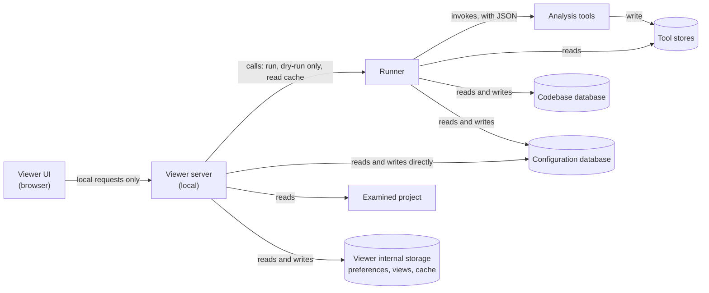

# ZaAnSouVi Viewer

Working specification for the Viewer, the main part of ZaAnSouVi. It covers the high-level concepts first. Security is a later step (section 8), and libraries and other low-level choices come last (section 9).

Each item is marked:
- **[Decided]**: agreed in discussion.
- **[Proposed]**: inferred from the decisions, to be confirmed or changed.

## 1. Purpose

- **[Decided]** The Viewer is the main part of ZaAnSouVi and **the main entry point to the toolset**: users start runs, follow them and explore the results from it. At its core is a **node graph viewer**. It shows the relations in the examined TypeScript codebase as interactive graphs, at every level: symbols, modules and infrastructure.
- **[Decided]** **The Viewer is a separate program that runs beside the tools** and is independent of them (section 2). Besides showing graphs, it is used to:
  - **manage the tools' configuration** (4.11)
  - **add tools to, or omit them from, the Runner's order** (4.11)
  - **list the known facts** about the examined application and its data (4.12)
- **[Decided]** It runs locally on the developer's machine and never depends on an online service.
- **[Decided]** Its audience is developers who already know the examined codebase. Every element shown must be traceable back to the exact source.

## 2. Parts

The Viewer has two parts: a **Viewer UI** that runs in the browser, and a **Viewer server** that runs locally on the same machine.

- **[Decided]** **The Viewer stays a TypeScript and HTML app in the browser, with a local server** (confirmed by the user on 2026-11-08, after weighing a desktop window wrapping the same page and a native UI against the needs of starting it from a shell, the file manager or a desktop shortcut; `mvp_docs/99_findings.md`, `FND-62`). Whether to wrap the page in a desktop window later is `VW-38`, deferred until the MVP's findings.
- **[Decided]** **The Viewer is independent of the tools.** It does not follow the tools' format: it has no `--info` or manifest, no place in the run order and no entry in the data topology (`data_topology.md`). It gets the stored facts as it needs them: the configuration database directly, and the tools' data and the codebase database through the Runner (3.1).
- **[Decided]** **The Viewer writes tool configuration**, in the format each tool declares for its config. This is how the config manager saves changes (4.11, 4.13). It writes no tool outputs and nothing in the codebase database.
- **[Decided]** **The Viewer has internal storage of any kind** for its own data: preferences, views, node positions, UI state and the cache. Its form is the Viewer's own choice, and no tool reads it.
- **[Proposed]** Since the Viewer is not a tool, it doesn't need to follow the common tool conventions (one output folder, plain text or JSON, the dry-run option). It still uses the shared library to read the facts.

## 3. Viewer server

### 3.1 Responsibilities
- **[Decided]** **Reads the configuration database directly**, since it holds configuration that affects both the Viewer and the Runner (`toolset.md`, section 5.2). That includes the record of available tools and their ordering (`runner.md`, sections 1.0 and 2).
- **[Decided]** **Gets codebase data through the Runner**, never by reading the codebase database itself. (This replaces the earlier "reads the toolset's outputs, including the database".)
- **[Decided]** Reads the examined project, for example to show source around a location.
- **[Decided]** **Calls the Runner with parameters useful for visualization**, such as dry-run only (status and correctness) and read cache (exactly what the Runner cached for a run configuration) (`runner.md`, sections 10 and 10.2).
- **[Decided]** The Runner has an output mode for the Viewer, with easily parsable data for the backend; `--human` gives text for people instead (`runner.md`, section 10.1). The `--human` format and the preferred output are configurable and kept in the configuration database (`toolset.md`, section 5.2).
- **[Decided]** **The Viewer's backend shares the configuration database with the Runner and may edit it directly.** The Runner and the Viewer must stay in sync on it as part of development (`toolset.md`, section 5.2).
- **[Decided]** The config manager shows and changes these settings by editing the configuration database directly, as a manual save with the confirmation dialog (4.13). The Viewer still never writes the codebase database.
- **[Decided]** Real runs stay unchanged whatever the Viewer passes, and **the same data can be recreated by the user calling the Runner by hand** (`runner.md`, section 10).
- **[Decided]** **The Viewer may keep its own cache or database, through the backend, if it is required at all.** It lives in the Viewer's internal storage (section 2).
- **[Proposed]** The same goes for tool outputs in the tool stores: the server gets them by calling the Runner (read cache), never by opening the stores, so the Runner stays the only reader of the codebase's data.
- **[Decided]** **The Viewer uses only the Runner's output** (decided by the user on 2026-11-08). A user may replace the Runner with their own scripts to run the tools (`toolset.md`, section 2), but what such scripts produce is irrelevant to the Viewer. If the Viewer should later use anything else, such as the tool stores directly, that is a new decision.
- **[Decided]** **The Viewer examines the data, preferring to read the Runner's cache** (decided by the user on 2026-11-07; `runner.md`, section 10.2). The Runner's cache is separate from the Viewer's own cache (section 5).
- **[Decided]** Runs the tool steps on request from the UI, through endpoints.
- **[Decided]** Generates and serves data in a format only the Viewer needs (see section 5). This data lives in the Viewer's internal storage (section 2).
- **[Decided]** Saves the Viewer's own settings and preferences in its internal storage.
- **[Decided]** **The server does all the parsing and interpreting; the UI only displays.** The server reads and interprets the toolset's configuration and outputs, and prepares what each page shows. The UI never parses config files or tool outputs itself.
- **[Decided]** Parses the configuration of the **entire toolset** for the config manager (4.11), and saves changes to it after the user confirms (4.13).
- **[Proposed]** Produces the human-readable text overview for the status page (4.12).

### 3.2 Running tool steps
- **[Decided]** The Runner treats every invocation the same, whether it comes from the Viewer or the command line (`runner.md`).
- **[Decided]** **The Viewer doesn't create tool parameters of its own.** It delegates that to the Runner, which may have Viewer-specific parameters; no tool has any (`runner.md`, section 1).
- **[Proposed]** So re-running a failed tool from the UI (4.14) goes through the Runner too, or invokes the tool with no parameters so it repeats its `last_run.json` exactly. A run started from the Viewer is logged and recorded exactly like a command-line run.
- **[Proposed]** The server adds no analysis logic. It runs the same tools the command line uses, with the same options and precedence. Options chosen in the UI act like command-line overrides for that run. Everything the UI can trigger can also be done from the command line.
- **[Proposed]** Runs are one at a time, keeping the toolset's no-concurrency rule. The server queues requests: one run per codebase at a time, and a second request waits or is rejected. The Runner's own lock enforces this for every way of starting a run, the command line included (`runner.md`, section 4, decided on 2026-11-07).
- **[Proposed]** Progress, logs and diagnostics are sent to the UI while the run happens.
- **[Proposed]** A run can be cancelled. A cancelled or failed run leaves the last good Viewer data untouched (see section 5).
- **[Decided]** **A tool run overwrites the tools' work data**, and the tools write only current data (`toolset.md`, section 5.3). After each run, the Viewer **re-reads what is relevant according to the Runner's output** for that run, for example which tools ran, which changed their outputs and which failed.
- **[Decided]** The Viewer can access all the data the tools have saved, through the Runner (3.1). A failing tool writes no partial data, so what the Viewer gets is always a tool's last complete output.
- **[Proposed]** Since the tools keep only current data, the Viewer's cached last saved run is the only copy of an earlier state. When the user rejects a pending version, the Viewer keeps showing its cache and marks it as older than the data on disk.
- **[Decided]** **The Viewer doesn't start runs automatically.** A run starts only when the user asks, for example through a function that reloads the Viewer's graph. Such a run is a manual run, like one started from the command line, and replaces the Runner's cache (`runner.md`, section 10.2; decided by the user on 2026-11-07).
- **[Decided]** The Viewer never switches data on its own. The last saved run is treated as current until the user manually refreshes or re-runs tools. A run the user starts from the UI shows its result when it finishes. A run started elsewhere, for example from the command line, appears only after a manual refresh.
- **[Decided]** A real run started from the Viewer fails early at the first error. The Viewer shows the diagnostic and keeps showing the last saved run.

**Dry run from the Viewer**
- **[Decided]** The user can start a **dry run** from the Viewer. It works as a **report** (changed files and similar information), a **preview** (what a real run would produce) and a **status check** (warnings about failures that can be prevented, such as a missing output from an earlier tool). It changes no work data: no tool writes anything in a dry run. That rule binds the tools only; the Viewer and the Runner may write whatever is useful during a dry run, such as the Viewer cache or the database (decided by the user on 2026-11-07; `toolset.md`, section 4.3). The last saved run and the current visualization stay as they are.
- **[Decided]** **A dry run never affects the graph visualization.** The Runner leaves alone the cache the Viewer uses; it may add diagnostic information, which the Viewer displays, for example in the drawer (decided by the user on 2026-11-07; `runner.md`, section 10.2).
- **[Proposed]** The dry-run result is shown in the drawer:
  - files added, changed and removed since the last saved run
  - which tool outputs a real run would create, update or leave alone
  - the status check: preventable failures, each with its cause and, where possible, what to do, for example "run the symbol step first"

  From there the user can start the real run.
- ~~**[Proposed]** The preview can also be shown in the graph area, marked clearly as a preview.~~ Dropped: a dry run never affects the graph visualization (decision above).
- **[Proposed]** The result's items are traceable like everything else: each changed file links to its source.
- **[Decided]** A dry-run result is not saved as Viewer data. The Runner keeps its diagnostics in its cache until the next dry run or real run (agreed by the user on 2026-11-07) (`runner.md`, section 10.2), so the Viewer can show them again until then; a real run clears them.

### 3.3 Interface
- **[Proposed]** The server's endpoints are a contract, defined as carefully as the file formats between tools. They cover:
  - starting, following and cancelling runs
  - listing codebases and the views available for each
  - fetching Viewer data and diagnostics
  - reading and saving the Viewer config

### 3.4 Lifecycle
- **[Proposed]** The default one-command run ends by starting the server and opening the UI in the browser.
- **[Proposed]** The server can also be started on its own over existing outputs, without running any analysis.
- **[Proposed]** Everything the UI needs is bundled with ZaAnSouVi, so it works fully offline.
- **[Decided]** **The server can load an examined source from a different folder without a restart** (decided by the user on 2026-11-08). The user picks another source root while it runs; any number of switches, in any order.
  - **[Decided]** So the Viewer **caches the data useful for reloading each examined source** it has shown, kept apart per source, so switching back shows that source again without a new run (section 5).
  - **[Decided]** **A cached entry the Viewer can't use fails cleanly**: when an entry is incompatible with the running Viewer (for example written in an older format), the Viewer doesn't show it, says why, and offers a new run for that source. It never guesses.
  - **[Decided]** **The Runner's and the tools' data can be cleared by hand** at any time, and the Viewer's own cache survives it: after clearing, the Viewer still shows each source's cached graph, and the next run rebuilds the Runner's and the tools' data.

## 4. Viewer UI

Sections 4.1 to 4.9 describe the **Viewer page**, the graph page. Sections 4.10 to 4.13 describe the page header, the other two pages, and how changes are saved.

### 4.1 Common graph model
- **[Decided]** Each view converts tool output into one common graph model, so all views share the same concepts and behavior.
- **[Proposed]** The model contains:
  - **Nodes:** stable ID, kind (variable, function, module, package, env var, resource…), label, source location, and the tool that produced it.
  - **Edges:** kind (reads, writes, calls, imports, extends, uses-env, deploys-to…), direction, and **their own source location**. For a read or write edge, that is where the read or write happens.
  - **Containment:** packages contain modules, and modules contain symbols. Grouping, collapsing and zoom levels depend on it.
  - **Provenance:** for each element, which tool output and which input state it came from.
- **[Proposed]** Because IDs are stable across tools, the same element has the same ID in every view. The user can follow it from one view to another.

### 4.2 Views
- **[Decided]** Each kind of tool output has a view. All views share the same base data, the toolset's outputs, but each view presents it in its own way (see 4.3 for the visual language).
- **[Decided]** Example: **variables in a module.** Each variable is shown where it is defined, with an edge to every place it is read and every place it is written. Read edges and write edges are drawn differently.
- **[Decided]** Other views follow the same pattern: calls, imports and exports, type use, env var reads, and code-to-infrastructure links.
- **[Proposed]** A view is defined by three things: which data it shows (one or more outputs), how that data maps onto the common model, and how it is laid out.
- **[Proposed]** The views that exist for a codebase are listed from the global record of which tool outputs exist, not hard-coded.

### 4.3 Visual language
- **[Decided]** Each view has its own icons, colors and line styles where its particular details benefit from them.
- **[Decided]** The same concept or object looks the same in every view that shows it. Example: a file has the same icon and the same color in every view where it appears.
- **[Decided]** A **reference** to an object looks different from the object itself, so the two are never confused. Example: a reference to a file gets a different icon or color from the file, marking it as a reference.
- **[Proposed]** The styles come from one shared catalog that all views use, at two levels:
  - **By kind:** an icon, shape and line style for each kind of node and edge (file, variable, module, env var, resource; reads, writes, imports…). Same kind, same look, everywhere.
  - **By identity:** a color for each specific object (this file, this module), assigned from its stable ID. The same object keeps the same color in every view and across runs.
  - A view may add styles for details only it shows, but never redefines a style from the catalog.
- **[Proposed]** A reference keeps a visible link to what it refers to, for example the target's color combined with a reference marker or icon. The user can see both that it is a reference and what it points to.
- **[Proposed]** Color is never the only signal. Icons, shapes and line styles carry the same meaning, for accessibility and for when colors run out.
- **[Proposed]** There are only so many colors that people can tell apart. In large graphs, identity colors are applied at a chosen grouping level, such as package or module, rather than to every file. Each view has a legend.

### 4.4 Interaction
- **[Decided]** All views share the same navigation, filtering and selection.
- **[Decided]** Selecting a node or edge shows its file:line, the code quote and the source link, in the details drawer (see 4.8). A link is pinned to a commit only when the file matches what was analyzed.
- **[Proposed]** Search by name, path or ID.
- **[Proposed]** Filter by node or edge kind, package or folder, and read or write.
- **[Proposed]** Focus on one node and its neighbors up to a chosen number of steps away.
- **[Proposed]** Expand and collapse groups.
- **[Proposed]** The details for an edge show both ends and where the reference itself is. The details for a variable list every read and write site, each with its quote and link.

### 4.5 Arranging nodes
- **[Decided]** **Layout design is central to the Viewer's readability**, not a detail of rendering (decided by the user on 2026-11-09). Where nodes are placed decides whether a view can be read at all: what belongs together, what is inside what, where "here" ends and what is elsewhere. Layout gets its own design work, weighed like the visual language (4.3), and is a main answer to the readability of large graphs (`toolset.md`, section 9). Evidence from the MVP: a force layout alone placed nodes differently on every entry and made a symbol look unrelated to the scope declaring it; a predictable start, a frame for the scope being viewed, and its contents and the stubs placed by rule were judged by the user to improve readability (`mvp_docs/99_findings.md`, `FND-72` and `FND-73`; `mvp_docs/50_viewer_ui.md`, `UI-32` and `UI-37`). How to lay out each view is open (`VW-39`).
- **[Decided]** The graph viewer can **zoom** and **pan**.
- **[Decided]** It can automatically **sort, align and distribute** nodes, and the user can **move each node by hand**.
- **[Decided]** Node positions belong to each view. Moving a node in one view does not move it in another.
- **[Proposed]** Automatic arranging works on everything or on a selection, so the user can tidy one area without losing manual work elsewhere.
- **[Proposed]** Positions are saved as the Viewer's own data, per codebase and per view, keyed by the nodes' stable IDs. This doesn't break the rule that the Viewer never writes other tools' outputs.
- **[Proposed]** Saved positions are separate from the run cache, so they survive new runs. After a run, known nodes keep their positions, new nodes are placed without moving existing ones, and nodes that no longer exist are dropped.

### 4.6 Rendering and scale
- **[Decided]** GPU-accelerated rendering for large graphs, and SVG where it fits better: small graphs, crisp export, accessibility, text-heavy views.
- **[Proposed]** The rendering mode is chosen automatically by graph size, and the user can override it.
- **[Proposed]** Large graphs open with groups collapsed, and show more detail as the user zooms in.
- **[Proposed]** Layouts stay stable between runs, because developers rely on remembering where things are (see 4.5).

### 4.7 Relation to Mermaid
- **[Proposed]** The current view, or the part in focus, can be exported as a Mermaid diagram built from the common graph model.

### 4.8 Page layout
- **[Decided]** The Viewer page has these parts:
  - **The graph area:** the node graph of the current view.
  - **A details drawer:** the technical details for the current view.
  - **A status bar.**
- **[Proposed]** The status bar shows the state of things at a glance: the codebase, whether what is shown is the last saved run, a pending version or a dry-run preview, whether a run is in progress, and the number of warnings. Selecting an item opens its details in the drawer.
- **[Proposed]** The drawer's content depends on the view and the selection. With nothing selected, it shows a summary of the view and its legend. With a node or edge selected, it shows the traceability details: file:line, quote, link, and for references every site with its quote and link. It also shows the view's diagnostics: skipped or malformed items, and a pending version waiting for a decision.
- **[Decided]** **Guideline: buttons that change how the content is shown sit in its bottom right corner** (decided by the user on 2026-11-09). Controls that change only the display (zoom, fit, filters, which levels or items are listed, expanding a panel) align to the bottom right of the content they act on, in one of two forms:
  - **a column**, ~~with the functions that change least nearest the corner;~~ with the part that changes most (such as a count or a readout) kept in the corner, and the controls that affect the visualization above it (refined by the user on 2026-11-09). The intention: what needs the most attention stays in the same place visually in most cases, and so do the controls that change what is visible;
  - **a row**, ordered with the items that change most first, so the one that changes least ends in the corner. Example: `{count} [action 1] [action 2] [change display]`.
  - **The exception:** a layout meant to place its buttons in a way that suits its function better, such as the run configurations (4.14).
  - In the MVP: the zoom controls in the graph area (a column: the zoom readout in the corner, Fit and Text above it), the This view / All toggle in Problems, and the activity line's count and toggles (`mvp_docs/50_viewer_ui.md`, `UI-46`, `UI-57`, `UI-73`).
- **[Proposed]** The page always shows where the user is in the view hierarchy (see 4.9), for example as a breadcrumb: App › database.

### 4.9 Moving between views
- **[Decided]** The user can switch between views. Each view loads the data it needs when it is entered. Data that several views share is kept inside the Viewer and reused, not loaded again.
- **[Decided]** The views are arranged in a **hierarchy of levels defined by the app**. Users cannot configure it.
- **[Decided]** Zooming and moving between levels are kept apart:
  - **Mouse wheel:** ordinary zoom inside the current view. It never changes the view.
  - **Ctrl + mouse wheel:** moves between levels. Ctrl + wheel forward toward a node opens that node's lower-level view. Ctrl + wheel back goes to the higher-level view.
  - **Double-click:** also moves between levels (see below).
- **[Decided]** Example of moving between levels: a view showing the codebase's infrastructure, App → { database, server, renderer }. Zooming in toward *database* opens the database overview: table names, row counts and similar details. Row counts come from a dedicated tool for that type of data, for example one that reads row counts from a SQLite file in the project ([Decided], `toolset.md`, section 6.7); reading from a running database is still open (`VW-18`). Where this infrastructure view sits in the hierarchy is not yet known (4.9.1).

#### 4.9.1 The levels

- **[Decided]** **Level 1, the overview** (the highest level): an overview of the entire examined codebase. It shows:
  - the project configuration
  - versions
  - file count
  - run configurations
  - which optional details are available, for example whether the project is AI-enabled, whether it has a known editor configuration, and whether it has a git configuration
- **[Decided]** The overview must be **extensible**: adding a new tool or a new kind of configuration adds to the overview without redesigning it.
- **[Decided]** **Level 2**: for each node of the project configuration shown in level 1, what is known about it. It also shows:
  - the **project structure** as directories
  - the project's **known outputs**: what the project produces, for example a command-line tool, a website or a library
- **[Decided]** **More levels exist below level 2, but they are not known yet.**
- **[Proposed]** To make the overview extensible, it doesn't know each tool in advance. Each tool contributes **facts** to it in one common shape: category, name, value, and where the fact was found (file and line, for traceability). The overview shows the facts by category, and a new tool's facts appear without changing the Viewer. This matches the rule that views are listed from the record of which outputs exist (4.2).
- **[Proposed]** Each fact in level 1 that has more to show is a node the user can zoom into, which leads to level 2 for that node.
- **[Proposed]** Optional details that are absent are still shown as absent, for example "no git configuration found". The user can then tell "not present" apart from "not checked".

- **[Proposed]** A lower-level view opens **for a specific object**: the database overview for *this* database. The object the user zoomed into is the view's focus, and saved positions (4.5) are kept per view and per focus object.
- **[Proposed]** Not every node has a lower level. The style catalog marks nodes the user can zoom into, so the user knows before trying.
- **[Proposed]** Ctrl + wheel forward goes into the node under the mouse pointer. Over empty space, or over a node with no lower level, nothing happens, and a short hint says so. The change of level is animated, so the user sees the node they entered become the new view.
- **[Proposed]** Double-click on a node goes down into it. A double-click on empty space, or the breadcrumb, goes back up.
- **[Proposed]** Returning to a level the user already visited restores where they were: the zoom, the pan position and the selection.
- **[Proposed]** Data for each view is loaded only on entry, and the shared data (for example the file inventory, the style catalog and identity colors) is loaded once. The data reflects the last saved run (section 5), so moving between views never mixes runs.

### 4.10 Page header and the pages
- **[Decided]** A header at the top of every page links to the functional parts of the UI.
- **[Decided]** **The number of pages is not decided yet.** It may change as more details are decided. The pages known so far:
  - **Viewer:** the graph page, with the graph area, the drawer and the status bar (4.1 to 4.9).
  - **Config manager:** the configuration of the entire toolset (4.11).
  - **Status:** a human-readable text overview of the entire toolset output (4.12).
- **[Decided]** The pages are **independent**. Each has its own functionality and does not depend on the others. They depend only on the toolset configuration.
  - **Run configurations:** the Runner configurations and their last known state (4.14). Whether this is its own page or part of the config manager is open (`VW-35`).
- **[Proposed]** Independence means each page works even if the others fail. For example, the config manager still works when there are no tool outputs yet, or when they are malformed. That is how the user fixes a configuration that stops runs from working.

### 4.11 Config manager
- **[Decided]** Shows a **grid of configuration variables and their values for the entire toolset**: the settings of every tool and the project-wide settings.
- **[Decided]** The user can override options **globally** (personal settings that apply to every codebase) or **per project**.
- **[Decided]** The server parses the configuration and prepares the grid. The UI only displays it and collects the user's edits.
- **[Proposed]** For each setting, the grid shows its effective value and **where that value comes from**: built-in default, global, project-wide or tool config. This follows the toolset rule that a run can explain where each setting came from (`toolset.md`, section 4.1).
- **[Proposed]** The grid also shows each setting's description, its default, and which tool uses it, so the user doesn't need to look elsewhere.
- **[Proposed]** Values are checked on the server before they can be saved. Invalid values are marked in the grid and block saving.
- **[Decided]** Changes are written **in the format each tool declares** for its configuration. The Viewer doesn't impose a config format of its own on the tools.
- **[Decided]** **The Viewer has its own Runner order**: which tools run when runs are started from the Viewer. The user can add tools to it or omit them from it. It is kept in the Viewer's internal storage.
- **[Decided]** The user can **save the Viewer's order as an override for the command-line Runner**. It is saved as a named Runner configuration file in the Runner's data (`runner.md`), in the format the Runner declares. This changes how the tools operate, so it is a manual save with the confirmation dialog (4.13).
- **[Proposed]** Saving the order doesn't change a command-line run by itself: the command line uses it only when the invocation names that file. The change preview says so, and shows the name to use.
- **[Proposed]** The Viewer can also load a named Runner configuration from the Runner's data as the starting point for its own order.
- **[Decided]** Adding or omitting a tool changes which tools run, never the order between them. The order comes from the ordering in the configuration database (`runner.md`, section 2).
- **[Decided]** **The Viewer installs no tools.** It can upload a file that the Runner reads to install a tool; only the Runner installs (`runner.md`, section 1.0). The details are deferred (`RN-19`).
- **[Decided]** **The Viewer always lists every tool in the record of tools**, and marks for each whether it runs or not.
- **[Decided]** **The user can update the named configuration to enable or disable each tool** from that list.
- **[Decided]** **The Viewer manages the inputs and outputs of the tools so that the configuration is always valid.**
- **[Decided]** **Disabling or enabling a tool does the same for all the tools it requires or that require it:** disabling a tool also disables the tools that depend on its output; enabling a tool also enables the tools that produce its inputs.
- **[Decided]** **If no tool is enabled, the configuration can't be saved.**
- **[Proposed]** The dependencies come from the ordering and the `--info` entries in the configuration database, so the Viewer needs no built-in knowledge of any tool.
- **[Proposed]** For each tool the list also shows whether it applies to this codebase and which tools depend on it. The change preview names every tool that a disable switches off along with it, and which views or facts would then be missing.
- **[Proposed]** The change preview lists every tool that was enabled or disabled along with the one the user changed, so nothing switches silently.
- **[Proposed]** The same rules apply to the Viewer's own Runner order and to a saved named configuration: whatever the Viewer saves is valid.
- **[Proposed]** The tool's declaration of its settings (`toolset.md`, section 4.1) is also what the server checks values against, so the Viewer never needs built-in knowledge of a tool.

### 4.12 Status page
- **[Decided]** Attempts to show a **text rendering of the entire toolset output** in a human-readable format.
- **[Decided]** It **lists the known facts** about the examined application and its data, as recorded by the tools.
- **[Proposed]** Facts that no tool has recorded, for example because their tool was omitted from the Runner's order, are listed as not known, with the reason.
- **[Decided]** The server produces the text. The UI only displays it.
- **[Proposed]** The text follows the same traceability rules as everything else: file:line references and links to the source.
- **[Proposed]** It reflects the last saved run, like the Viewer page, and says so.
- **[Proposed]** "Attempts" follows the best-effort rule (section 6): parts that can't be rendered are reported, not hidden, and the rest is still shown.

### 4.13 Saving changes
- **[Decided]** **Two kinds of saving:**
  - **Manual, with confirmation:** anything that changes **how the tools operate**, such as tool, project-wide and global configuration, or **which run the Viewer treats as its last saved run**, such as accepting a pending version. The tools' data itself is written only by the tools (`toolset.md`, section 5.3); the Viewer's choice changes only its own internal storage.
  - **Automatic, where it makes sense:** the user's working state in the UI, such as the current view, node positions and settings that only affect the UI. They change nothing about the tools or their results.
- **[Decided]** A manual save opens a **confirmation dialog** that shows **what will change**, as a text overview that previews the data that will be saved. The change is written only after the user confirms.
- **[Proposed]** The overview lists each change as the old value and the new value, grouped by where it is saved (global, project-wide or a tool's config). Settings that are not changed are left out.
- **[Proposed]** The server prepares the overview, consistent with the rule that the UI only displays.
- **[Proposed]** Automatic saving covers, for example: the current page and view, the zoom and pan position, the selection, node positions (4.5), drawer state, and display preferences such as the rendering mode. Restoring a view on return (4.9) relies on it.
- **[Proposed]** The config manager keeps the two kinds apart: UI-only settings are saved automatically, settings that affect the tools need the confirmation dialog. Each setting is marked as one or the other.

### 4.14 Run configurations view
- **[Decided]** The Viewer has a **view for configuring runs**. It lists **all available Runner configurations** (the named files in the Runner's data, `runner.md`, section 3) and the **last known state** of each.
- **[Proposed]** The last known state comes from the Runner's own listing (`runner.md`), which the server reads like any other fact. The Viewer adds no state of its own to it.
- **[Proposed]** For each configuration it shows: its name, the tools it includes and omits, when it last ran, the outcome, the failures and errors, and the files processed. Failures and errors keep their source locations and links, like every other diagnostic.
- **[Proposed]** A configuration that has never run is listed as "never run", not hidden.
- **[Proposed]** This is where the Viewer's own order (4.11) is edited, saved as a named configuration, or started from an existing one. Starting a run or a dry run with a chosen configuration is possible from here too.
- **[Proposed]** The Runner's log of each run (`runner.md`) can be opened from here, shown as text.
- **[Decided]** The UI **shows the user what has failed and offers options to fix it**. Repeating a failed tool run is as simple as invoking the tool again from the UI (`toolset.md`, section 4.5).
- **[Proposed]** For a failed tool, the UI shows its `last_run.json` (the parameters and outcome of the failed run) and its log. Fixing options could include editing the parameters or the configuration and running the tool again, running a dry run first, or opening the source location named in the failure.
- **[Proposed]** Like the rest of the Viewer, the state shown is the last known one. It is refreshed after a run started from the Viewer finishes, or when the user refreshes manually (3.2).

## 5. Viewer data and cache

- **[Decided]** The Viewer caches its own data, so a running tool never makes the UI show incomplete data or fail to load.
- **[Proposed]** The cache, including a pending version, is part of the Viewer's internal storage (section 2). Accepting a pending version changes only that storage, never tool outputs.
- ~~**[Proposed]**~~ **[Decided]** (per codebase: decided by the user on 2026-11-08, section 3.4; per view still proposed) The cache is kept per codebase and per view, and always holds the last complete, valid Viewer data.
- **[Proposed]** Viewer data is rebuilt only after a tool run has finished, from the outputs of that run, re-reading only what the Runner's output says changed (3.2). The new data is built next to the current cache and replaces it in one step, only when the build succeeds and is complete.
- **[Decided]** **Partly malformed output needs the user's approval.** When the rebuild finds partly malformed tool output, the new data does not replace the cache automatically. It becomes a **pending version**:
  - the Viewer shows the pending version with the malformed or skipped parts **marked visually in the graph area**, not only in a diagnostics list
  - the Viewer **asks the user** whether to save the pending version as the new complete version
  - **Accept:** a manual save with the confirmation dialog (4.13). The pending version replaces the cache and becomes the new last-known-good. It keeps its markings and diagnostics, so it stays visibly partial later.
  - **Reject:** the pending version is discarded. The Viewer keeps showing the previous complete version, marked as stale, with the reason.
- **[Decided]** **At most two versions are kept, and no history:**
  - the **last saved run**: the last complete run, or the last partial run the user accepted
  - the **current visualization**: what is on screen, which differs from the last saved run only while a pending version awaits the user's decision

  When a pending version is accepted it becomes the last saved run, and the previous saved run is dropped. When it is rejected it is dropped. A newer run replaces any pending version that is still waiting.
- **[Proposed]** Until the user decides, the last saved run stays cached. The user can switch between the pending version and the last saved run to compare them before deciding.
- **[Proposed]** If no one is there to decide, for example after a command-line run with no Viewer open, the pending version is kept and nothing is replaced. The Viewer asks the next time the user refreshes or opens it.
- **[Decided]** The decision is one per run, not one per view, because there is only one saved run and all its views describe the same snapshot.
- **[Proposed]** Each cache entry records what it was built from: input state, tool outputs and their schema versions, Viewer version, and the Viewer config settings that affect the data. A change to any of these marks that entry for rebuilding, and nothing else.
- **[Proposed]** The UI says plainly when what it shows is not the latest, and why. For example: "Showing results from the previous run; the latest symbol run failed." It also says plainly when what it shows is a pending version awaiting the user's decision.
- **[Proposed]** If the Viewer's own cache is damaged, the server rebuilds it from the tool outputs.

## 6. Malformed or missing data

- **[Decided]** When tool outputs are malformed, the Viewer makes a fair effort and shows only what it can.
- **[Decided]** **Checking the data is the Viewer's job, all of it** (decided by the user on 2026-11-08). The Viewer checks the output of every run before it uses or stores it: that it is valid as Viewer data, not only well-shaped. The Runner checks only shape (`runner.md`, section 10) and never checks content on the Viewer's behalf; each tool still answers for its own output (`toolset.md`, section 4.2).
- **[Decided]** **The Viewer survives bad data** (decided by the user on 2026-11-08): bad data never stops the server or affects another examined source, and never replaces the Viewer's last good data for that source (section 5). After a restart or a reload, the same data gives the same result.
- **[Decided]** **The UI says when a run's output has extra data or invalid data** (decided by the user on 2026-11-08): extra data is data the Viewer received but doesn't use or doesn't fully understand (shown generically or not at all); invalid data is data that failed the Viewer's checks (skipped). Each is listed with where it came from (data name, tool, record), not only counted.
- **[Proposed]** Since real runs fail early instead of writing doubtful output (`toolset.md`, section 4.4), a normal run should not produce malformed output. Malformed data reaching the Viewer is expected to come from outputs edited by hand or damaged on disk, from a schema version the Viewer doesn't know, or from a defect in a tool. The rules below, and the pending version in section 5, cover those cases.
- **[Proposed]** The tolerance is applied on the server, while Viewer data is built. The UI receives only data that has been checked.
- **[Proposed]** How each problem is handled:

| Problem | Behavior |
|---|---|
| A whole output file is missing or unreadable | That view, or that layer of a combined view, is unavailable with a clear reason. Other views still work. |
| Unknown schema version | Read the fields it understands, ignore the rest, and mark the view "partially understood". |
| A malformed record | Skip that record and keep the rest of the file. |
| An edge whose source or target is missing | Show a marked "unresolved" endpoint or hide the edge (`VW-4`), and count it either way. |
| An unknown node or edge kind | Draw it with a generic style. |
| A missing source location | Show the element, but mark its link and quote as unavailable. |

- **[Proposed]** Showing part of the data is acceptable. Showing it without saying so is not. Each view shows how much was skipped and why, and every skipped item can be traced to its output file and record.
- **[Proposed]** The Viewer never fills gaps with guesses. It shows less rather than something wrong.
- **[Proposed]** A view never mixes data from two different runs.

## 7. Open questions

- `VW-1` ~~**Stale or partial**~~: resolved. Partly malformed output becomes a pending version, marked visually, and the user decides whether to save it (section 5).
- `VW-2` **How much to skip:** is skipping single malformed records acceptable, or does one malformed record make the whole file untrusted?
- `VW-3` ~~**Other tools' config**~~: resolved. The config manager edits the configuration of the entire toolset, globally or per project, with manual save and confirmation (4.11, 4.13).
- `VW-4` **Unresolved edges:** shown as marked placeholder nodes by default, or hidden with only a count?
- `VW-5` ~~**Fixing from the Viewer**~~: resolved. Yes: the UI shows what failed and offers options to fix it, and running a tool again is as simple as invoking it from the UI (4.14).
- `VW-6` **Codebases per server:** one server for all stored codebases with a switcher in the UI, or one server per codebase?
- `VW-7` ~~**Watching for changes**~~: resolved. No watching. The user always starts runs or refreshes manually (section 3.2).
- `VW-8` **Source access:** may the server serve source text beyond the recorded quotes, for example the whole file around a reference?
- `VW-9` **Static export:** is a read-only export of a view that works without the server needed, for sharing with someone who didn't run the tools?
- `VW-10` **Combined views:** are views that combine several tool outputs in scope from the start, or only one view per output at first?
- `VW-11` **Comparing two states:** is it in scope to compare two states of the same codebase, for example before and after a change?
- `VW-12` ~~**Decide per run or per view**~~: resolved. One decision per run (section 5).
- `VW-13` ~~**Several pending versions**~~: resolved. A newer run replaces a pending version that is still waiting (section 5).
- `VW-14` **Showing the difference:** when asking, should the Viewer highlight what differs between the pending version and the previous complete one, not only what is malformed?
- `VW-15` **Color assignment:** which grouping level gets identity colors by default (file, module, package), and can the user pin a color to a specific object?
- `VW-16` **Style catalog customization:** can users change the shared icons, colors and line styles, for example in the Viewer config, as long as the same concept stays consistent across views?
- `VW-17` **Arranging and saved positions:** when the user runs automatic arranging, does it override manual positions, or only place nodes that were never moved by hand?
- `VW-18` **Row counts and other runtime data** *(partly answered: each type of runtime data falls to its own tool, for example SQLite row counts read from a SQLite file in the project; `toolset.md`, section 6.7)*: is reading from a running database or service, rather than from files in the project, in scope? If it is, it is a separate optional tool with its own concerns (`security.md`, section 10). Same question as `TS-5`.
- `VW-19` **The full level hierarchy** *(partly answered: levels 1 and 2 are defined in 4.9.1)*: which levels exist below level 2, and in what order? Where do the infrastructure, module and symbol views fit? Which lower views does each kind of node open into?
- `VW-20` **Several lower views:** a node may have more than one useful lower view. For example, a server could open into its modules, its routes or its env vars. Which one does zooming in open, and can the user pick another from the drawer?
- `VW-21` **Switching views at the same level:** besides moving up and down, can the user switch sideways between views of the same object, for example from a module's variables view to its calls view?
- `VW-22` **Ctrl + wheel conflicts:** in browsers, Ctrl + wheel normally zooms the whole page, and pinch-to-zoom on a trackpad usually reaches the page the same way as Ctrl + wheel. Should the Viewer take over Ctrl + wheel inside the graph area? How should trackpad users zoom inside a view without changing level by accident? Is there a keyboard alternative for moving between levels?
- `VW-23` **Status bar contents:** is the proposed content of the status bar right (4.8), and where are runs and dry runs started from: the status bar, the header, or the drawer?
- `VW-24` **Status page structure:** how is the text overview organized? For example, by level (infrastructure, modules, symbols), by tool, or by file. Is it one long page or split into sections?
- `VW-25` ~~**Manual save everywhere**~~: resolved. Only changes to how the tools operate and to saved run data are saved manually; UI state such as the current view and node positions is saved automatically (4.13).
- `VW-26` **Order of global and per-project settings:** when a setting is set both globally and per project, the per-project value presumably wins. Where do global settings sit in the full precedence order (`toolset.md`, section 4.1)? Same question as `TS-16`.
- `VW-27` **Naming:** "Viewer" names both the whole UI and the graph page. Should the graph page get its own name, for example "Graph"?
- `VW-28` **Run configurations** *(related: the Runner configurations of ZaAnSouVi now have their own view, 4.14)*: in level 1, does "run configurations" mean how the examined project is run (for example its scripts and launch settings), how ZaAnSouVi was run on it, or both?
- `VW-29` **AI-enabled:** what makes a project count as "AI-enabled"? For example, configuration or instruction files for AI coding assistants, or the use of AI libraries in the code. Should the overview list which assistants or libraries it found?
- `VW-30` **Versions:** which versions does level 1 show? For example, the project's own version, the TypeScript and runtime versions it targets, and the versions of its main dependencies.
- `VW-31` **Several packages:** in a monorepo, does level 1 show one overview for the whole repository, with each package as a node, or one overview per package? Does each package have its own known outputs in level 2?
- `VW-32` **Level 2 as one view or several:** are the configuration details, the directory structure and the known outputs one combined view, or separate views of the same level?
- `VW-33` ~~**Omitting a tool others depend on**~~: moved to `RN-4` (`runner.md`).
- `VW-34` ~~**Naming saved Runner orders**~~: moved to `RN-5` (`runner.md`).
- `VW-35` **Where the run configurations view lives:** is it part of the config manager page, or a fourth page in the header (4.10)?
- `VW-36` ~~**Direct reads or through the Runner**~~: resolved. The configuration database is read directly; the codebase database goes through the Runner (3.1). Tool stores are proposed to go through the Runner too. For the MVP this detail may be omitted (`MVP_scope.md`).
- `VW-37` ~~**Enabling a tool with disabled inputs**~~: resolved. Enabling a tool also enables the tools that produce its inputs; the Viewer keeps the configuration always valid, and won't save one with no tool enabled (4.11).
- `VW-38` **A desktop window around the page** *(deferred until the MVP's findings; decided by the user on 2026-11-08 to keep the browser for now)*: wrap the same HTML page in a desktop window (one that ships its own browser engine, or one that uses the system's), so closing the window stops the Viewer, there is no open local port or token, and only one instance runs. Against: a large dependency, packaging, and an app harder to inspect than a page. It would replace the [Decided] browser and local server in section 2, so it needs a new decision. To answer it: how much the browser's lifecycle (stopping, a second start) and its security handling (token, origin checks) cost in practice in the MVP. Starting it from GNOME Files or a shortcut needs the same care either way.
- `VW-39` **Layout strategy** *(deferred until the MVP's findings; raised by the user on 2026-11-09, who sees layout management as a very interesting subject to explore after the MVP)*: how each view places its nodes (4.5). Directions found in the MVP (`mvp_docs/99_findings.md`, `FND-72`, `FND-73`), none decided: layouts by rule, where a node's place follows from what it is (the entered scope as a frame, its contents inside, other places around it); a layered layout following the direction of edges (tied to which way arrows point, `FND-71`); frames for containers such as scopes; positions the user moved, remembered per codebase and per view (4.5, [Proposed]); and stability across code changes, so a familiar view stays familiar from run to run (4.6). To answer it: which layouts read best for each level and view, how they scale to large graphs, and whether they can be predictable without being rigid.
- `VW-40` **Arrow direction** *(deferred until after the MVP; raised by the user on 2026-11-09)*: should an edge's arrow point from a definition to where it is used, instead of from the using end to the definition, as the MVP draws it (`mvp_docs/50_viewer_ui.md`, `UI-39`)? The user would prefer the first; it may be improved after the MVP. Section 4.3 states no direction yet. Tied to a layered layout that follows the direction of edges (`VW-39`) (`mvp_docs/99_findings.md`, `FND-71`).
- `VW-41` **Navigating between nodes and searching the project** *(deferred until after the MVP; raised by the user on 2026-11-09)*: navigation between nodes needs to be more explicit, and the user needs a way to search for what is within the project. The MVP moves only by double-clicking a node and by the breadcrumb; a dropdown in the breadcrumb listing the nodes that can be entered was offered and not built (`mvp_docs/99_findings.md`, `FND-71`). Related: search by name, path or ID (4.4, [Proposed]); moving between levels (4.9).

## 8. Later step: security

Security concerns, including those of the Viewer server and UI, are tracked in `security.md`. They are a later step, after the high-level concepts and before libraries and specifics.

## 9. Deferred to the final technology section

- GPU and SVG rendering libraries, layout engines, and the exact rule for switching between them
- the server runtime and framework, and the transport used for progress updates. Current leaning: a local Node server, "or something similar" (user's words). [Decided] The Viewer and the Runner are TypeScript and form a unit (`runner.md`, section 1.0).
- the form of the Viewer's internal storage (preferences, views, data and cache)
- how tool outputs and the codebase database are read on the server
